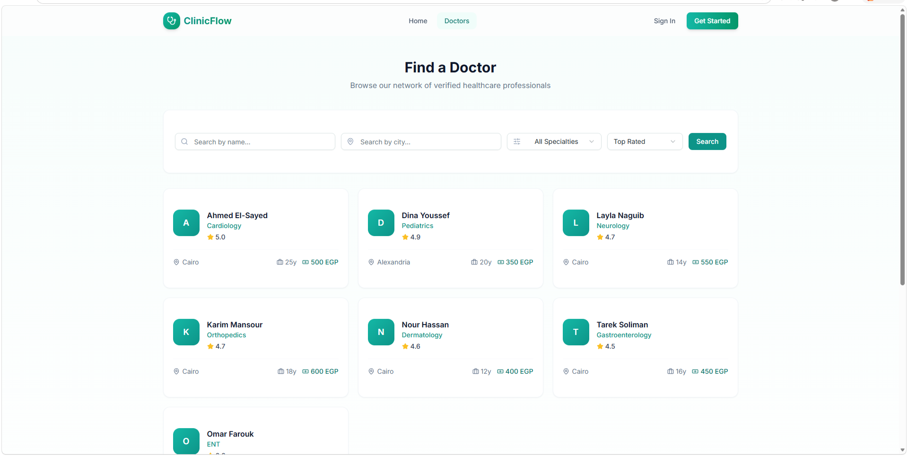
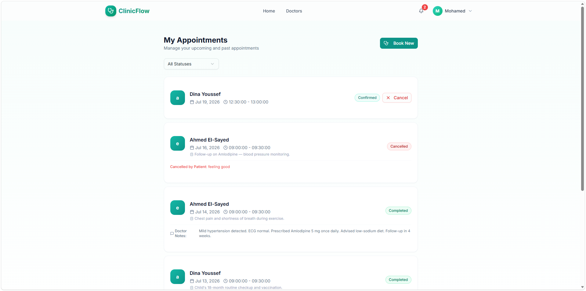
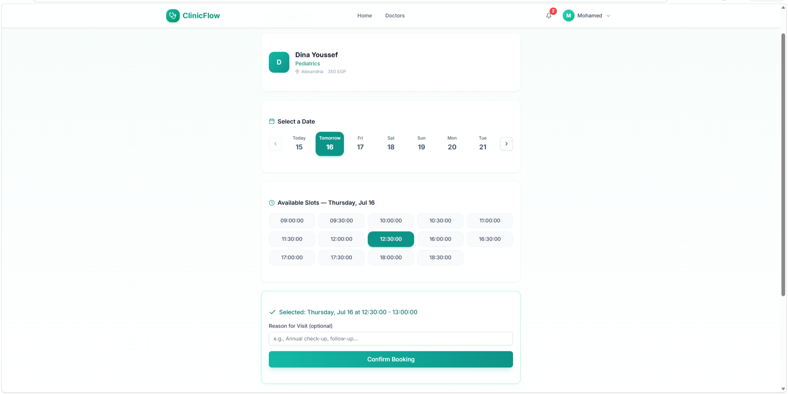
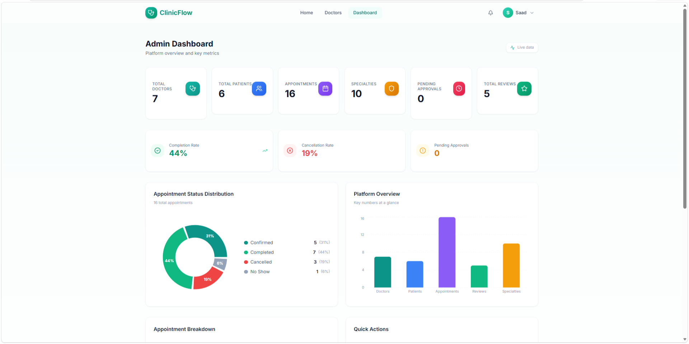
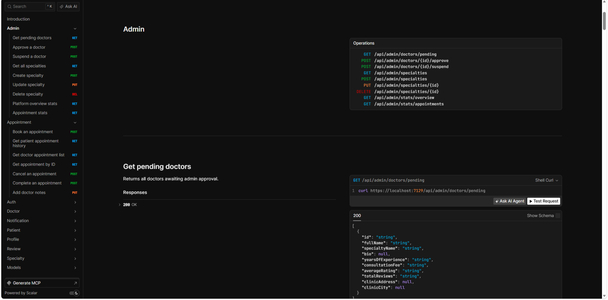

# 🏥 ClinicFlow

> Full-stack clinic management system: a **.NET 10** REST API + **React/TypeScript** frontend, built with Clean Architecture.

ClinicFlow lets patients find doctors and book appointment slots, doctors publish weekly schedules and manage their visits, and admins approve doctors and manage specialties. It covers:
- JWT authentication with rotating refresh tokens and login lockout
- email confirmation, password reset and appointment emails
- an hourly reminder job
- in-app notifications
- reviews with cached doctor ratings

This repository is the backend. The React frontend lives in its own repository, and both apps follow the shared **[API contract](docs/API_CONTRACT.md)**.

**→ [Frontend Repository](https://github.com/S3d0o/ClinicFlow-Frontend) · [Live API Docs](https://registry.scalar.com/@default-team-2gu37/apis/clinicflow-v1@1.0.0) · [Live Demo on LinkedIn](https://www.linkedin.com/posts/saad-mohamed-li_dotnet-csharp-react-ugcPost-7483058574588379136-R35x/?utm_source=social_share_send&utm_medium=member_desktop_web&rcm=ACoAAFtidxABr0vs0HxJVu7Xnwvp_d1T8J8FNdM)** *(video walkthrough)*

---

## 📸 Screenshots

### Doctor Search & Booking

*Browse doctors by specialty and city, view ratings and consultation fees*

### Patient Appointments

*View upcoming and past appointments, cancel or leave a review*


*Choosing a slot for a specific day marked as confirmed after booking*

### Admin Panel

*Approve pending doctors, view platform statistics*

### Scalar API Docs

*Interactive API documentation — [explore live](https://registry.scalar.com/@default-team-2gu37/apis/clinicflow-v1@1.0.0)*

---

## 📚 Documentation

| Document | What's in it |
|---|---|
| [docs/PROJECT_OVERVIEW.md](docs/PROJECT_OVERVIEW.md) | Roles, features, domain model, business rules, architecture |
| [docs/API_CONTRACT.md](docs/API_CONTRACT.md) | **Shared backend ↔ frontend contract:** endpoints, payloads, errors, auth and session rules, TypeScript types |
| [docs/openapi.json](docs/openapi.json) | OpenAPI 3.1 document generated from the API |
| [docs/SETUP_AND_DEPLOYMENT.md](docs/SETUP_AND_DEPLOYMENT.md) | Configuration, running locally, tests, Docker, production checklist, troubleshooting |
| [docs/REVIEW.md](docs/REVIEW.md) | Code review: known issues and their fix status |
| [docs/v2/README.md](docs/v2/README.md) | **V2 plan (draft):** clinic operations for a multi-branch clinic: roles, front desk, EMR, billing, insurance, roadmap |
| [CLAUDE.md](CLAUDE.md) | Conventions and commands for contributors (and AI assistants) |

## ✨ Features

- **Three roles:**
  - **Patient:** books, cancels and reviews appointments.
  - **Doctor:** manages schedule, appointments and notes.
  - **Admin:** approves or suspends doctors, manages specialties, sees stats.
- **Doctor onboarding:** doctors register and confirm their email; an admin approves them before they appear in search.
- **Schedules and slots:** one weekly schedule per weekday. Bookable slots are generated automatically for the next 14 days.
- **Safe booking:** a conditional database update inside a transaction guarantees a slot is booked only once.
- **Cancellation rules:**
  - Patients can cancel up to 2 hours before the appointment.
  - Doctors and admins can cancel at any time.
  - The slot becomes bookable again.
- **Reviews:** one review per completed appointment, 1–5 stars. The doctor's rating is recalculated.
- **Reminders:** an hourly background job emails and notifies patients about appointments in the next 24 hours.
- **Security:**
  - Refresh tokens are stored hashed and rotated on every use. Reusing an old token revokes the user's sessions.
  - Login locks the account after 5 failures.
  - Owner-only access to appointment details.
- **Result pattern:** services return `Result`/`Result<T>`, which map to consistent ProblemDetails responses.
- **Observability:** Serilog with console, rolling-file and Seq sinks; every request is logged with its trace id.
- **OpenAPI and Scalar:** interactive docs at `/scalar` in Development.

## 🏛️ Architecture

```
ClinicFlow.slnx
├── Domain                 entities, enums, repository interfaces, IUnitOfWork
├── Shared                 DTOs, Result/Error, error catalogues, settings        → Domain
├── Persistance            EF Core DbContext, configurations, migrations,         → Domain
│   (Persistence.csproj)   repositories, UnitOfWork, DataSeeder
├── Services.Abstraction   service interfaces                                     → Shared
├── Services               business logic, AutoMapper, email, JWT                 → Domain, Persistence, Services.Abstraction
├── Presentation           controllers, FluentValidation validators, filter       → Services.Abstraction
├── ClinicFlow             host: DI, middleware, reminder job, startup seeding    → Persistence, Presentation, Services
├── ClinicFlow.Tests               unit tests (xUnit + NSubstitute)
└── ClinicFlow.IntegrationTests    API tests (WebApplicationFactory + Testcontainers SQL Server)
```

More detail is in [docs/PROJECT_OVERVIEW.md](docs/PROJECT_OVERVIEW.md#5-architecture).

## 🛠️ Tech stack

### Backend

| Concern | Technology |
|---|---|
| Runtime | .NET 10, ASP.NET Core 10 |
| Data | Entity Framework Core 10, SQL Server 2022 |
| Auth | ASP.NET Core Identity, JWT bearer, rotating refresh tokens |
| Validation / mapping | FluentValidation 12, AutoMapper 16 |
| Email | MailKit |
| Logging | Serilog (Console · File · Seq) |
| API docs | ASP.NET Core OpenAPI + Scalar |
| Tests | xUnit, NSubstitute, FluentAssertions, Testcontainers |
| Containers | Linux multi-stage Dockerfile, docker-compose (db + backend + frontend) |

### Frontend

| Layer | Technology |
|---|---|
| Framework | React 19 + TypeScript |
| Routing | React Router v7 |
| Styling | Tailwind CSS + shadcn/ui |
| Animations | Framer Motion |
| HTTP client | Axios |
| Date handling | date-fns |

## 🚀 Getting started

```bash
git clone https://github.com/S3d0o/ClinicFlow-Backend.git
cd ClinicFlow-Backend

# SQL Server (or use a local instance)
docker run -d --name clinicflow-sql -e ACCEPT_EULA=Y -e MSSQL_SA_PASSWORD='<pwd>' -p 127.0.0.1:1433:1433 mcr.microsoft.com/mssql/server:2022-latest

# required secrets
dotnet user-secrets set "ConnectionStrings:DefaultConnection" "Server=127.0.0.1,1433;Database=ClinicFlow;User Id=sa;Password=<pwd>;TrustServerCertificate=True" --project ClinicFlow
dotnet user-secrets set "JwtSettings:Secret" "<at least 32 random characters>" --project ClinicFlow

# run: applies migrations and seeds demo data in Development
dotnet run --project ClinicFlow/ClinicFlow.csproj
```

Open http://localhost:5143/scalar. For the demo logins, email settings and all options, see [docs/SETUP_AND_DEPLOYMENT.md](docs/SETUP_AND_DEPLOYMENT.md).

```bash
dotnet test ClinicFlow.Tests               # unit tests
dotnet test ClinicFlow.IntegrationTests    # integration tests (Docker must be running)
```

## 🐳 Docker

```bash
docker build -t clinicflow-backend .   # Dockerfile is at the repo root
cp .env.example .env                   # fill in DB_PASSWORD, JWT_SECRET, EMAIL_*, ADMIN_*
docker compose up -d                   # frontend :3000, backend :5001
```

## 🔐 Authentication flow

```
POST /api/auth/register/patient   → confirmation email (link to the frontend's /#/confirm-email)
POST /api/auth/confirm-email      → account confirmed
POST /api/auth/login              → { accessToken (15 min), refreshToken (7 days), role, ... }
Authorization: Bearer <accessToken>
POST /api/auth/refresh-token      → new token pair; the old refresh token stops working
POST /api/auth/logout             → revokes the caller's refresh token
```

The frontend's session rules (single-flight refresh, reuse detection, lockout) are in [API_CONTRACT.md §2](docs/API_CONTRACT.md#2-authentication-and-sessions).

## 🤝 Contributing

1. Create a feature branch: `git checkout -b feature/your-feature`
2. Follow the conventions in [CLAUDE.md](CLAUDE.md). If you change an endpoint, update [docs/API_CONTRACT.md](docs/API_CONTRACT.md) and [docs/openapi.json](docs/openapi.json) in the same PR (see the [change process](docs/API_CONTRACT.md#11-how-to-change-this-contract)).
3. Make sure `dotnet build` has no warnings and both test projects pass.
4. Open a pull request against `master`.

## 👤 Author

**Saad Mohamed**
- GitHub: [@S3d0o](https://github.com/S3d0o)
- LinkedIn: [linkedin.com/in/saad-mohamed-li](https://linkedin.com/in/saad-mohamed-li)
