# ClinicFlow V1: The Complete Guide

| | |
|---|---|
| **What this is** | One document that explains all of ClinicFlow V1: what it does, every user flow end to end, the rules behind them, how the code is built, how to run, test and deploy it, and what is still open |
| **State described** | Backend `master` at the V1 merge (2026-10-18), API contract **3.1.2** |
| **Audience** | Anyone joining the project: developers (backend or frontend), testers, the product owner |

For field-by-field request and response details, the source of truth is [API_CONTRACT.md](API_CONTRACT.md). This guide explains *how things work and why*; the contract says *exactly what goes over the wire*. If the two ever disagree, the contract and the code win, and this guide should be fixed.

---

## Contents

1. [What ClinicFlow is](#1-what-clinicflow-is)
2. [Roles and what each can do](#2-roles-and-what-each-can-do)
3. [Architecture](#3-architecture)
4. [Domain model](#4-domain-model)
5. [Flows, end to end](#5-flows-end-to-end)
6. [State machines](#6-state-machines)
7. [Time rules: the clinic clock](#7-time-rules-the-clinic-clock)
8. [The API at a glance](#8-the-api-at-a-glance)
9. [Errors](#9-errors)
10. [Security](#10-security)
11. [Configuration](#11-configuration)
12. [Running, demo data and tests](#12-running-demo-data-and-tests)
13. [Deployment](#13-deployment)
14. [Working in the codebase](#14-working-in-the-codebase)
15. [Known limitations and what is open](#15-known-limitations-and-what-is-open)
16. [Where to find everything](#16-where-to-find-everything)
17. [Glossary](#17-glossary)

---

## 1. What ClinicFlow is

ClinicFlow is a clinic-booking platform:

- **Patients** find doctors, see their free time slots, book appointments, cancel them, and review the visit afterwards.
- **Doctors** publish weekly working hours, which the system turns into bookable slots, and manage their appointments: cancel, complete, add notes, mark no-shows.
- **Admins** approve or suspend doctors, manage the list of medical specialties, and can act on any appointment.

The system is two apps:

| App | Repository | Technology |
|---|---|---|
| Backend (this repo) | `ClinicFlow-Backend` | .NET 10 REST API, SQL Server, EF Core |
| Frontend | `ClinicFlow-Frontend` | React (hash routing) |

They agree on the API through [API_CONTRACT.md](API_CONTRACT.md); the frontend keeps an identical copy.

### In V1

Accounts with email confirmation and password reset, doctor discovery, schedules and slots, booking with double-booking protection, cancellation, completion, doctor notes, no-shows, reviews with a cached average rating, in-app notifications, email reminders, admin approval and statistics, specialty management.

### Not in V1 (planned for V2, see [v2/](v2/README.md))

Multiple clinics or branches, staff roles beyond the three above, receptionist booking, medical records (EMR), billing, insurance, real-time push notifications, SMS, an outbox for reliable email. V1 has **one clinic**, in **one time zone**.

---

## 2. Roles and what each can do

Every account has exactly one role: `Patient`, `Doctor` or `Admin`.

| Capability | Anonymous | Patient | Doctor | Admin |
|---|:-:|:-:|:-:|:-:|
| Register, log in, confirm email, reset password | ✅ | | | |
| Search doctors, view a doctor's profile, reviews and free slots | ✅ | ✅ | ✅ | ✅ |
| List specialties | ✅ | ✅ | ✅ | ✅ |
| Read and update own account profile (name, phone, picture, birth date) | | ✅ | ✅ | ✅ |
| Read and update own medical profile | | ✅ | | |
| Book an appointment | | ✅ | | |
| List own appointments | | ✅ | ✅ | |
| Read one appointment | | own | own | any |
| Cancel an appointment | | own, ≥ 2 h before start | own, any time | any, any time |
| Complete an appointment, write doctor notes | | | own | |
| Mark a no-show | | | own | any |
| Review a completed appointment | | own, once | | |
| Delete a review | | own | | any |
| Manage own schedule (weekly hours) | | | ✅ | |
| Update own doctor profile (bio, fee, clinic) | | | ✅ | |
| Notifications inbox | | ✅ | ✅ | ✅ |
| Approve or suspend doctors, see the pending queue | | | | ✅ |
| Create, update, deactivate or delete specialties | | | | ✅ |
| Platform statistics | | | | ✅ |

**"Own"** is checked in the service layer, not just by role: a patient can only touch their own appointments, a doctor only appointments with them. A wrong role gets 403 without an error code; the right role but someone else's record gets 403 with a code such as `Appointment.Unauthorized`.

### How accounts come to exist

| Role | How |
|---|---|
| Patient | Self-registration, then email confirmation |
| Doctor | Self-registration, then email confirmation, then **admin approval** before patients can see them |
| Admin | The bootstrap admin from configuration (`Seeding:AdminEmail` / `Seeding:AdminPassword`), or the demo admin in Development. There is no endpoint to create admins |

---

## 3. Architecture

### 3.1 Projects (Clean Architecture)

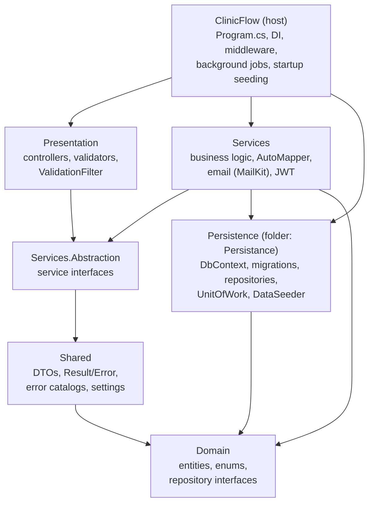

| Project | What lives there |
|---|---|
| `Domain` | Entities (`Entities/AppModule`, `Entities/IdentityModule`), enums, `IUnitOfWork`, repository interfaces, filter parameter types |
| `Shared` | Request/response records (`DTOs/<Feature>/`), the `Result` / `Error` types, `<Feature>Errors` catalogs, settings classes |
| `Persistance` (project `Persistence`) | `ClinicDbContext`, one `<Entity>Config` per entity, migrations, repositories, `UnitOfWork`, `DataSeeder` |
| `Services.Abstraction` | `I<Name>Service` interfaces, `IEmailService`, `ITokenService`, `IDateTimeProvider` |
| `Services` | `<Name>Service` implementations, AutoMapper profiles, DI registration (`CoreServiceExtensions`) |
| `Presentation` | Controllers (all inherit the abstract `ApiController`), FluentValidation validators, the global `ValidationFilter` |
| `ClinicFlow` | The host: `Program.cs`, infrastructure registration, the two background jobs |
| `ClinicFlow.Tests` | Unit tests (xUnit + NSubstitute) |
| `ClinicFlow.IntegrationTests` | HTTP-level tests against a real SQL Server in a container |

### 3.2 What happens to a request

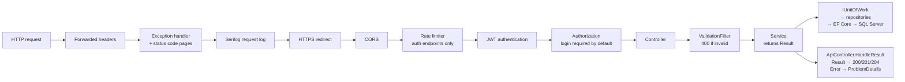

1. **Middleware.** An unhandled exception becomes a 500 ProblemDetails without internals; an empty 401/403/404 gets a ProblemDetails body. CORS allows only the configured frontend origin. The rate limiter only touches the six credential and email endpoints.
2. **Authorization.** A fallback policy requires a logged-in user. Public endpoints are marked `[AllowAnonymous]` explicitly; a test fails if any action declares neither.
3. **Validation.** The `ValidationFilter` runs the `<Request>Validator` for each body or query object and returns 400 with the field errors.
4. **Service.** Business rules live here. Expected failures (not found, conflict, forbidden, rule violated) are returned as an `Error`, never thrown.
5. **Data access.** Services only see `IUnitOfWork`, which exposes the repositories. Transactions come from `uow.BeginTransactionAsync()`.
6. **Response.** `ApiController.HandleResult` turns success into 200/201/204 and an `Error` into a ProblemDetails with the status that matches its `ErrorType`.

### 3.3 Key design choices

| Choice | Why |
|---|---|
| **Result pattern** | Business failures are values, not exceptions. One place (`ApiController`) maps `ErrorType` to the HTTP status: NotFound→404, Conflict→409, Forbidden→403, Validation→400, Unauthorized→401, Failure→500 |
| **Unit of Work + repositories** | Services never touch `ClinicDbContext`. Repositories are created lazily per request and are not registered in DI |
| **Double-booking guard in the database** | A conditional `UPDATE … WHERE Status = Available` inside a transaction. If it changes 0 rows, someone else booked first |
| **Side effects after commit** | Notifications and emails run after the main change is saved. If they fail, the failure is logged and the request still succeeds |
| **Rotating refresh tokens, stored hashed** | A stolen database dump contains no usable tokens; reuse of an old token is detected |
| **Clinic-local slot times** | Slots are wall-clock times in the clinic's zone, compared against the clinic's clock, not UTC (section 7) |
| **Startup migrations and seeding** | `dotnet run` brings a fresh database to the current schema; demo data only in Development |

---

## 4. Domain model

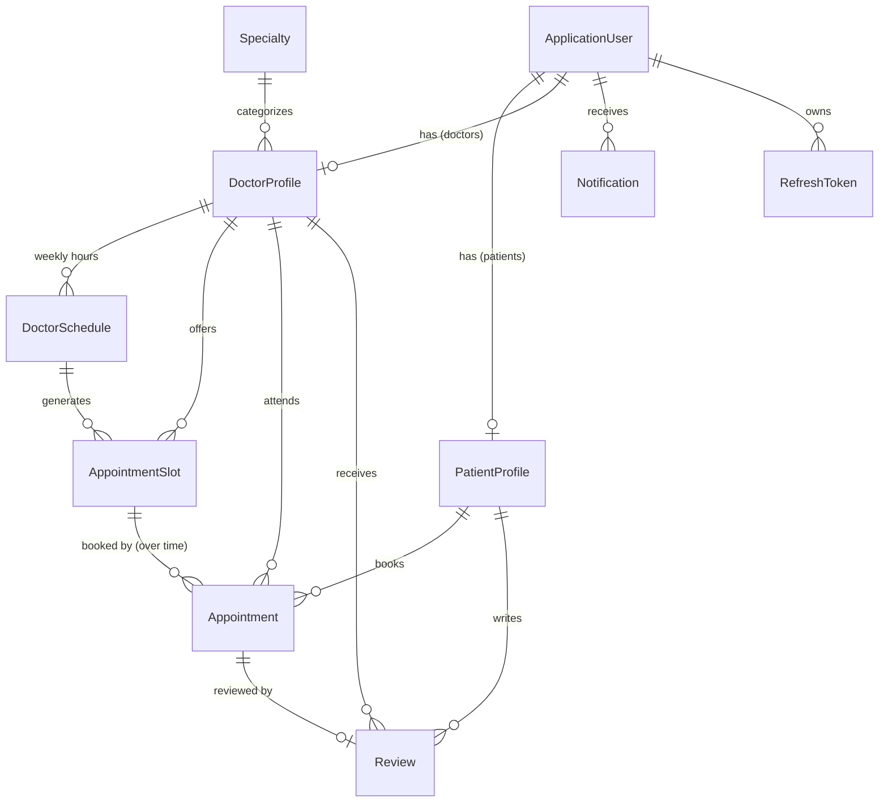

| Entity | Key fields | Notes |
|---|---|---|
| `ApplicationUser` | Email, password hash, first/last name, phone, gender, date of birth, `IsActive`, `EmailConfirmed` | ASP.NET Identity user with a GUID id. `IsActive = false` means suspended |
| `PatientProfile` | Blood type, allergies, chronic conditions, emergency contact | One per patient account |
| `DoctorProfile` | Specialty, bio, years of experience, consultation fee (EGP), clinic address and city, `IsApprovedByAdmin`, `AverageRating`, `TotalReviews` | The rating fields are a cache, recomputed whenever a review is added or deleted |
| `Specialty` | Name (unique, case-insensitive), description, icon URL, `IsActive` | Inactive specialties are hidden from public reads and from doctor registration |
| `DoctorSchedule` | `DayOfWeek`, `StartTime`, `EndTime`, `SlotDurationMinutes`, `IsActive` | The weekly template. At most one per doctor per weekday |
| `AppointmentSlot` | `Date`, `StartTime`, `EndTime`, `Status` (`Available`, `Booked`, `Blocked`) | A concrete bookable window, generated from a schedule. Unique per doctor, date and start time |
| `Appointment` | Status, reason for visit, doctor notes, booked-at, cancellation (when, by whom, why), `ReminderSentAt` | Links patient, doctor and slot |
| `Review` | Rating 1–5, comment (≤ 300 chars), `IsVisible`, created-at | At most one per appointment (unique index) |
| `Notification` | Title, message, type, `IsRead`, `RelatedEntityId` | `RelatedEntityId` is not a foreign key; for appointment events it holds the appointment id |
| `RefreshToken` | Token hash (SHA-256), expiry, created/revoked info, the token that replaced it, the user's security stamp | One row per issued refresh token; used ones stay as history |

**Things that surprise people:**

- **A slot can have several appointments over time.** When an appointment is cancelled, the appointment row stays (history) and the slot is freed, so another patient can book it. Only one appointment per slot is ever *active*.
- **Slots referenced by an appointment are never deleted**, because the database keeps the history (`NoAction` foreign key). That is why schedules with history are deactivated instead of deleted, and why some free slots are *blocked* rather than removed (section 5.6).
- **Enums are stored and sent as strings** (`"Confirmed"`, `"Monday"`).

### Enums

| Enum | Values |
|---|---|
| `AppointmentStatus` | `Pending` (never set in V1), `Confirmed`, `Cancelled`, `Completed`, `NoShow` |
| `SlotStatus` | `Available`, `Booked`, `Blocked` |
| `CancelledBy` | `Patient`, `Doctor`, `Admin` |
| `NotificationType` | `AppointmentReminder`, `AppointmentConfirmed`, `AppointmentCancelled`, `AppointmentCompleted`, `SystemAlert` |
| `DoctorSortBy` | `Rating`, `Fee`, `Experience` |
| `Gender` | `Male`, `Female` |
| `BloodType` | `APositive`, `ANegative`, `BPositive`, `BNegative`, `OPositive`, `ONegative`, `ABPositive`, `ABNegative` |

---

## 5. Flows, end to end

Each flow lists the endpoints involved (with their number from the contract's endpoint index), the rules, and the side effects. The numbers (#1, #18, …) match [API_CONTRACT.md §4](API_CONTRACT.md#4-endpoint-index).

### 5.1 Patient registration and email confirmation

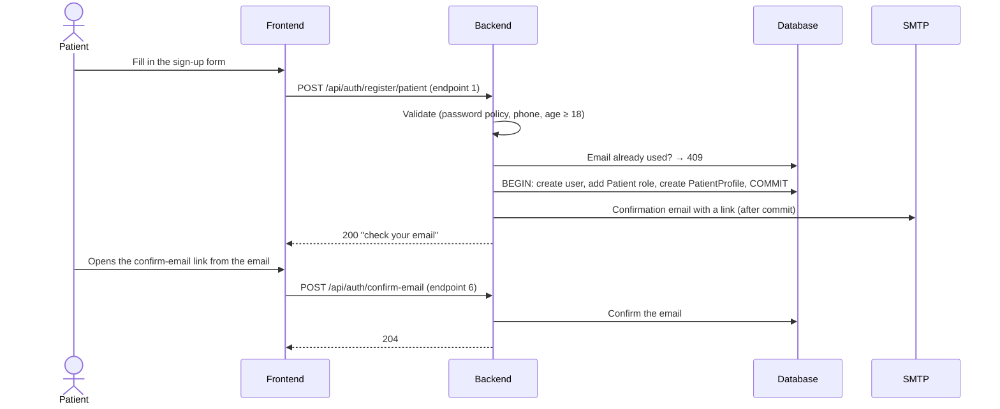

- **Validation:** names ≤ 50, valid email, password ≥ 8 with upper case, lower case, a digit and a special character, phone in E.164 (7–15 digits), age ≥ 18 if a birth date is given.
- **One transaction** creates the user, the role and the profile. If any step fails, nothing is left behind.
- **The email is sent after the commit.** If sending fails, registration still succeeds and the failure is logged. (There is no "resend confirmation" endpoint yet; see section 15.)
- **Before confirming, the user can't log in** (401 `Auth.EmailNotConfirmed`).
- **Rate limited** (section 5.3).

### 5.2 Doctor registration, approval and suspension

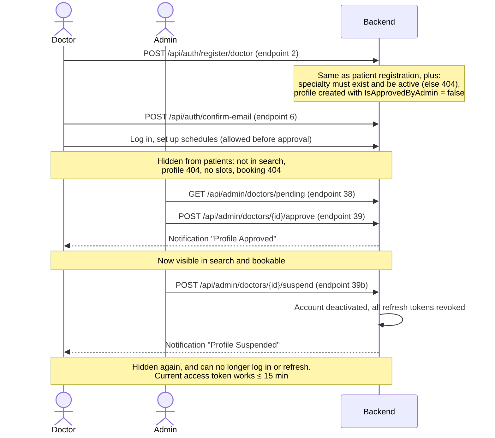

- Doctor registration adds: specialty id (must be an existing **active** specialty), years of experience 0–70, consultation fee > 0 and ≤ 10 000, bio ≤ 500, clinic address ≤ 300, city ≤ 100.
- **Approval gates visibility, not login.** An unapproved doctor can log in and prepare schedules; patients just can't see or book them.
- Approving twice → 409 `Admin.DoctorAlreadyApproved`; suspending twice → 409 `Admin.DoctorAlreadySuspended`.
- The pending queue lists unapproved, **active** doctors, oldest application first. The dashboard's `pendingApprovals` count uses the same rule.
- There is no "unsuspend" endpoint in V1.

### 5.3 Login, sessions, refresh and logout

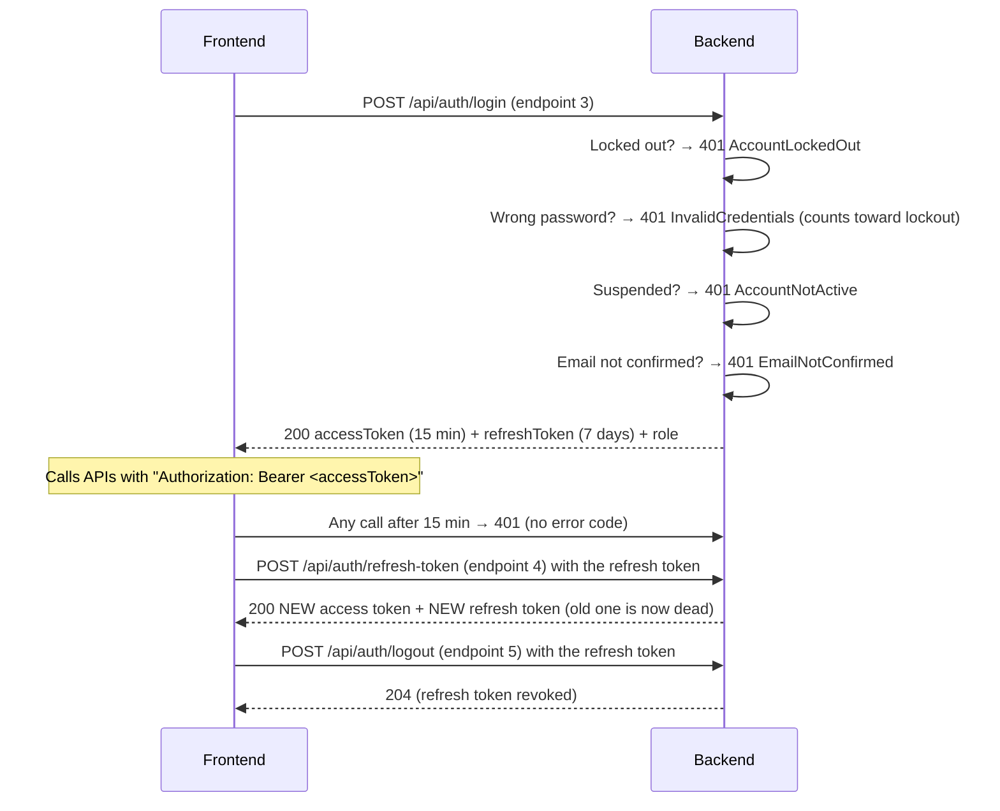

**Login rules**
- The password is checked **before** the account state, so an attacker can't learn whether an account exists, is suspended or unconfirmed without knowing the password.
- **Lockout:** 5 wrong passwords lock the account for 15 minutes. During that time every login, even with the right password, gets 401 `Auth.AccountLockedOut`.
- Use `role` from the login response to decide which UI to show.

**Tokens**
- **Access token:** a JWT (HMAC-SHA256), 15 minutes. Carries the user id, name, email and role.
- **Refresh token:** a random opaque string, 7 days, **single use**. Stored only as a hash.

**Refresh rules (the frontend must follow these)**
1. Refresh one at a time. Two parallel refreshes with the same token: one wins, the other gets 401.
2. Replace the stored refresh token as soon as a refresh succeeds; never reuse an old one.
3. **Theft detection:** reusing an already-rotated token from a different IP, or more than 5 minutes later, is treated as theft and **revokes every session of that user**. Reuse from the same IP within 5 minutes (two tabs racing) is only rejected.
4. 401 `Auth.InvalidRefreshToken` means the session is over (expired, revoked, rotated, user suspended, or password reset): clear the tokens and go to login.
5. A 5xx from refresh is not a logout: keep the tokens and retry later.

**Logout** revokes the given refresh token. It works **without** an access token (since 3.1.0), so a user can log out after the access token expired. If an access token is sent, the refresh token must belong to that user.

**Rate limiting (since 3.1.0).** Register (#1, #2), login (#3), confirm email (#6), forgot password (#7) and reset password (#8) share **one budget per client IP: 10 requests per 60 seconds** (configurable). Over it: 429 `RateLimit.Exceeded` with a `Retry-After` header. Refresh and logout are not limited, so staff behind one clinic IP don't lose their sessions. Lockout (per account) and rate limiting (per IP) apply independently.

### 5.4 Forgot and reset password

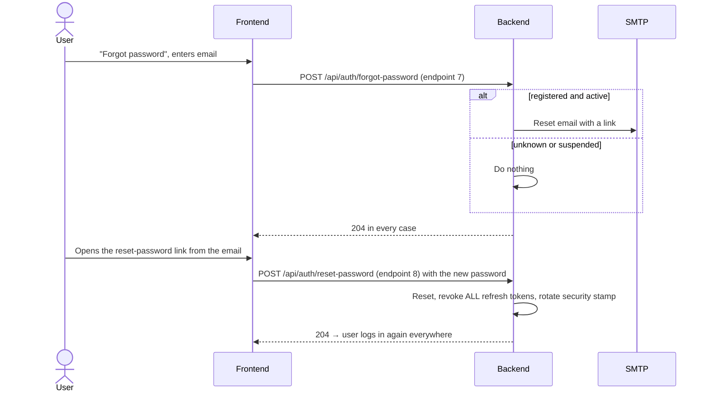

- **No email enumeration:** forgot-password always returns 204, even if the email is unknown or sending fails (the failure is logged). The page can't tell whether an email will arrive.
- The new password follows the registration rules.
- Reset ends every session on every device.

### 5.5 Profiles

| What | Endpoints | Who |
|---|---|---|
| Account profile: name, phone, profile picture URL, date of birth | `GET` / `PATCH /api/profile/me` (#30, #31) | Everyone logged in |
| Medical profile: blood type, allergies, chronic conditions, emergency contact | `GET` / `PATCH /api/patients/profile` (#28, #29) | Patients |
| Doctor profile: bio, experience, fee, clinic address and city | `PUT /api/doctors/profile` (#13) | Doctors |

- `PATCH` (and the doctor `PUT`) only change the fields you send; omitted or `null` fields keep their value. The doctor's fee is optional on update.
- A known gap: a patient can't *clear* a medical field, because an empty value means "keep the old one".

### 5.6 Schedules and slots (the doctor's working hours)

A **schedule** is a weekly template ("Mondays 09:00–17:00, 30-minute slots"). The system turns it into concrete **slots** ("2026-10-19 09:00–09:30") that patients can book.

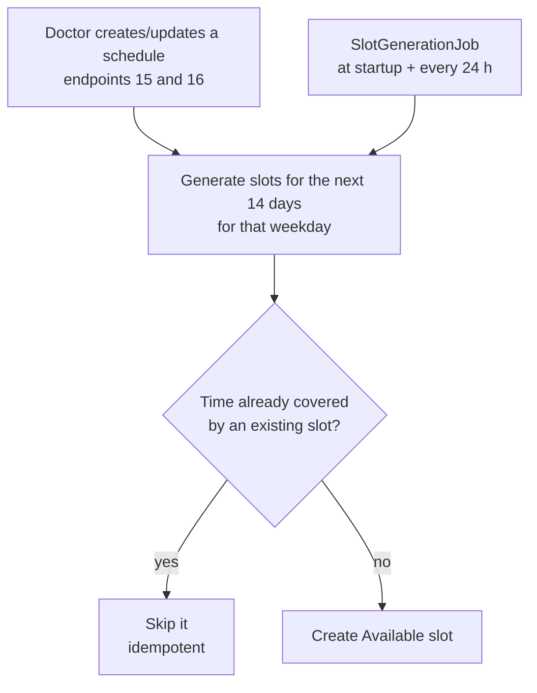

**Endpoints:** list (#14), create (#15), update (#16), delete (#17); all Doctor, own schedules only.

**Generation rules**
- Slots are generated for **today plus the next 13 days** (14 days), only on the schedule's weekday, only for **active** schedules.
- Only **whole** slots that end by `EndTime` are created (09:00–10:45 with 30 min gives 09:00, 09:30, 10:00; the 10:30 slot would overrun).
- Generation is **idempotent**: a time that overlaps any existing slot of that doctor is skipped, so running it again never creates duplicates.
- **`SlotGenerationJob`** runs at startup and every 24 hours and extends every active schedule, so the 14-day window rolls forward and never runs out.

**Creating** a schedule for a weekday that already has an **active** one → 409 `Doctor.ScheduleDayAlreadyExists`. If an **inactive** one exists for that day (kept for history, see delete), it is **reused** and reactivated with the new hours.

**Updating** (#16) changes only the fields sent, then, in **one transaction**:
1. Checks the merged result: end after start, and room for at least one slot (else 400 `Doctor.InvalidScheduleTime`).
2. Deletes future **free** slots that no appointment points to.
3. Keeps booked slots (the doctor must honour or cancel those) and free slots that a cancelled appointment points to.
4. **Blocks** kept free slots that the new hours no longer cover, and reopens blocked ones that the hours cover again (since 3.1.0).
5. Regenerates the rest of the window.

Setting `isActive = false` through an update removes future free slots, blocks kept ones and generates none.

**Deleting** (#17):
- Refused with 409 `Doctor.CannotDeleteScheduleWithBookedSlots` while upcoming booked appointments exist; the doctor cancels them first.
- Otherwise slots nobody ever booked are deleted. If slots with history remain (past or cancelled appointments), the schedule is **deactivated** instead of deleted, and its future kept slots are blocked.

**Slot listing for patients** (#11, `GET /api/doctors/{id}/slots?date=`): only `Available` slots of an approved, active doctor, ordered by time. An unknown doctor or a day off returns `[]`. `date` is required (400 without it).

### 5.7 Finding a doctor

| Endpoint | What |
|---|---|
| `GET /api/doctors` (#9) | Search: `name` (substring of the full name), `specialtyId`, `city` (substring), `sortBy` = `Rating` (default, highest first), `Fee` (cheapest first) or `Experience` (most first), paging 1–50 (default 10) |
| `GET /api/doctors/{id}` (#10) | Public profile with specialty |
| `GET /api/doctors/{id}/slots?date=` (#11) | Free slots on a date |
| `GET /api/reviews/doctor/{doctorId}` (#26) | Visible reviews, newest first, paged (1–20). Use this one; #12 is a duplicate planned for removal |
| `GET /api/Specialty` (#35) | Active specialties (for the search filter) |

Only **approved and active** doctors appear anywhere public. Sorting has a stable tie-breaker, so paging never repeats or skips a doctor.

### 5.8 Booking an appointment

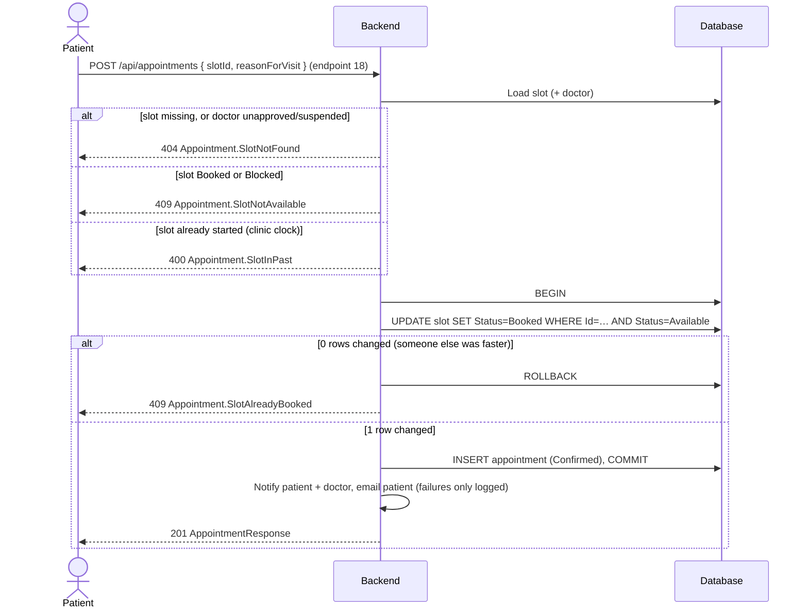

- **Double booking is impossible:** the conditional update is atomic in SQL Server. Of two simultaneous requests for one slot, exactly one changes the row.
- A booking is immediately `Confirmed` (there is no approval step; `Pending` is unused).
- Reason for visit ≤ 500 characters.
- The frontend should reload the slot list on any 409.

### 5.9 Cancelling an appointment

One endpoint, `POST /api/appointments/{id}/cancel` (#22), with an optional reason (≤ 500). The behaviour depends on who calls:

| Caller | Allowed when |
|---|---|
| Patient | Own appointment, and at least **2 hours before** the start (clinic clock), else 400 `Appointment.CancellationWindowExpired` |
| Doctor | Own appointment, any time |
| Admin | Any appointment, any time |

For everyone: an appointment that is already `Cancelled` (409 `AlreadyCancelled`), `Completed` (409 `AlreadyCompleted`) or `NoShow` (409 `AlreadyNoShow`) can't be cancelled.

On success:
1. Status `Cancelled`, with the time (UTC), who cancelled and the reason.
2. **The slot is freed** (`Available`) so someone else can book it, **unless** the doctor's schedule no longer covers it (hours moved away, or the schedule was deactivated): then it becomes `Blocked` (since 3.1.0).
3. Both the patient and the doctor get an `AppointmentCancelled` notification. No email is sent for cancellations.

### 5.10 Completing, notes and no-shows (the doctor's side)

| Action | Endpoint | Rules |
|---|---|---|
| Complete | `POST /api/appointments/{id}/complete` (#23) | Owning doctor only. Not before the start time (400 `CannotCompleteBeforeStart`). Not if cancelled (409 `CannotCompleteCancelled`), already completed or a no-show. The patient is notified and can now review |
| Doctor notes | `PUT /api/appointments/{id}/notes` (#24) | Owning doctor only. Replaces the notes (`null` clears them), ≤ 4000 chars. Not on cancelled appointments (409 `DoctorNotesNotAllowed`). Allowed on completed and no-show appointments |
| Mark no-show | `POST /api/appointments/{id}/no-show` (#24b) | Owning doctor or an admin. Only `Confirmed` appointments, and no earlier than **15 minutes after** the start (400 `NoShowTooEarly`). The patient is notified. Nothing is ever marked automatically |

Doctors see their appointments with `GET /api/appointments/doctor/my` (#20), filtered by status and paged; patients with `GET /api/appointments/my` (#19). Both newest first, default page size 10, max 50. One appointment: `GET /api/appointments/{id}` (#21), readable only by its patient, its doctor or an admin, because it contains medical notes.

### 5.11 Reviews and ratings

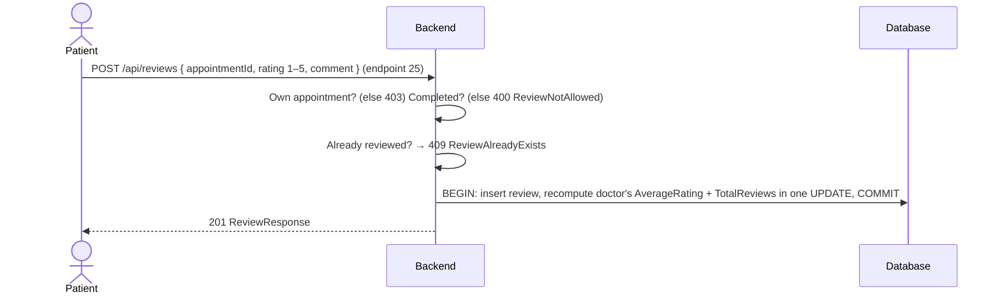

- One review per appointment, enforced by a unique index too (two simultaneous submissions: one 201, the rest 409).
- Ownership is checked **before** the duplicate check, so a patient can't learn whether someone else's visit was reviewed.
- **Deleting** (#27): the author or an admin. Doctors can't delete reviews about themselves. The rating cache is recomputed in the same transaction.
- `AverageRating` and `TotalReviews` on the doctor are a **cache** of the visible reviews, used for sorting and display.

### 5.12 Notifications

Every user has an in-app inbox:

| Endpoint | What |
|---|---|
| `GET /api/notifications/my?unreadOnly=&pageNumber=&pageSize=` (#32) | Newest first, default 50 per page, max 100. Total in the `X-Total-Count` header (use `unreadOnly=true&pageSize=1` to get the unread count cheaply) |
| `POST /api/notifications/{id}/read` (#33) | Mark one as read (403 if it's someone else's) |
| `POST /api/notifications/read-all` (#34) | Mark all of mine as read |

**Which events notify whom:**

| Event | Patient | Doctor | Type | Email? |
|---|:-:|:-:|---|---|
| Appointment booked | ✅ "Appointment Confirmed" | ✅ "New Appointment Booked" | `AppointmentConfirmed` / `SystemAlert` | Patient: booking confirmation |
| Appointment cancelled (by anyone) | ✅ | ✅ | `AppointmentCancelled` | No |
| Appointment completed | ✅ "you can now leave a review" | | `AppointmentCompleted` | No |
| Marked as no-show | ✅ "Missed Appointment" | | `SystemAlert` | No |
| Reminder (24 h before) | ✅ | | `AppointmentReminder` | Patient: reminder |
| Doctor approved | | ✅ "Profile Approved" | `SystemAlert` | No |
| Doctor suspended | | ✅ "Profile Suspended" | `SystemAlert` | No |

All other emails are account emails: registration confirmation and password reset. Notifications are polled (no push channel in V1). `RelatedEntityId` holds the appointment id for appointment events.

### 5.13 Reminders (background job)

`AppointmentReminderJob` runs **at startup and every hour**:

1. Finds `Confirmed` appointments whose slot starts within the **next 24 hours** on the clinic clock and that have no `ReminderSentAt` yet.
2. For each: sends the reminder **email first**, then saves the notification and `ReminderSentAt` together.
3. If the email fails, nothing is recorded, so the next run retries it. One failure doesn't stop the others.

Because the job has no distributed lock, run **one** backend instance (section 15).

### 5.14 Admin: specialties and statistics

**Specialties** (admin routes #40–#43 under `/api/admin/specialties`):
- List includes inactive ones. Create, update, delete.
- Names are unique, case-insensitively (409 `Specialty.NameAlreadyExists`).
- `isActive` on update deactivates or reactivates. Inactive specialties disappear from public reads and from doctor registration.
- Deleting a specialty that doctors use → 409 `Specialty.HasAssignedDoctors` (deactivate it instead).
- The old routes `POST/PUT/DELETE /api/Specialty` (#37) still work for admins but are deprecated.

**Statistics:**
- `GET /api/admin/stats/overview` (#44): total doctors, patients, appointments, specialties, reviews, and pending approvals.
- `GET /api/admin/stats/appointments` (#45): count per appointment status.

**Doctor management:** the pending queue, approve and suspend (section 5.2). Admins can also cancel any appointment, mark no-shows and delete any review. There is no admin list of *all* appointments in V1 (section 15).

---

## 6. State machines

### Appointment

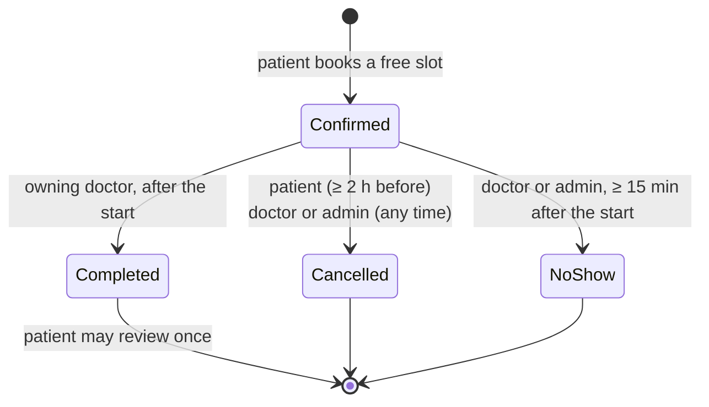

`Cancelled`, `Completed` and `NoShow` are final. `Pending` exists in the enum but nothing sets it in V1.

### Slot

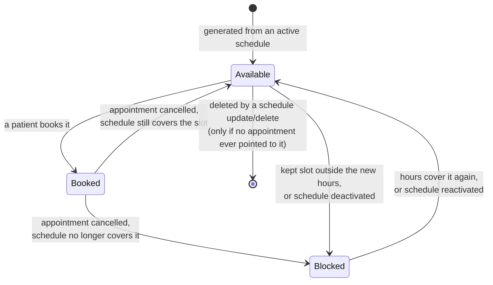

A `Booked` slot stays `Booked` after the appointment is completed or marked no-show.

---

## 7. Time rules: the clinic clock

V1 serves one clinic in one time zone, configured as `Clinic:TimeZoneId` (IANA id, default `Africa/Cairo`, checked at startup).

| Kind of value | Meaning | Example |
|---|---|---|
| Slot and schedule dates/times | **Clinic-local wall-clock time**, no zone attached. Show them as they are; never convert | `"date": "2026-10-19", "startTime": "09:30:00"` |
| Timestamps (`bookedAt`, `cancelledAt`, `createdAt`, …) | **UTC**. Read from the database without a `Z` suffix, so add one before parsing | `"2026-10-08T12:17:34.10"` means 12:17 UTC |

Every rule that compares a slot with "now" uses the **clinic's clock** (`IDateTimeProvider.ClinicNow`): the slot-in-the-past check, the 2-hour cancellation window, completion, the 15-minute no-show grace, the reminder window, and the slot generator's "today". Repositories never read the clock; services pass "now" in, which keeps the rules testable.

---

## 8. The API at a glance

### Conventions

| Topic | Rule |
|---|---|
| Base URL | Development `http://localhost:5143` (or `https://localhost:7129`); Docker compose `http://localhost:5001`. Everything under `/api` |
| Format | JSON, camelCase property names, enums as strings |
| Dates | `DateOnly` = `"yyyy-MM-dd"`, `TimeOnly` = `"HH:mm:ss"` (requests also accept `"HH:mm"`) |
| Money | `consultationFee` is a decimal number in EGP |
| Ids | Integers, except user ids (GUID strings) |
| Lists | Bare JSON arrays. Paged lists take `pageNumber` (1-based) and `pageSize`; notifications and pending doctors add an `X-Total-Count` header |
| Partial updates | `PATCH` endpoints and the schedule `PUT` apply only the fields sent |
| Auth | `Authorization: Bearer <accessToken>`. Every endpoint needs it unless marked anonymous below |
| CORS | Only the configured frontend origin. The browser can read the `X-Total-Count` and `Retry-After` response headers |
| Interactive docs | `/scalar` in Development; [openapi.json](openapi.json) is committed |

### Endpoint index

Auth: **—** anonymous; **Any** any logged-in user.

| # | Method | Route | Auth | Purpose |
|---|---|---|---|---|
| 1 | POST | `/api/auth/register/patient` | — | Patient sign-up |
| 2 | POST | `/api/auth/register/doctor` | — | Doctor sign-up |
| 3 | POST | `/api/auth/login` | — | Log in |
| 4 | POST | `/api/auth/refresh-token` | — | Rotate tokens |
| 5 | POST | `/api/auth/logout` | — (token optional) | Revoke a refresh token |
| 6 | POST | `/api/auth/confirm-email` | — | Confirm email from the link |
| 7 | POST | `/api/auth/forgot-password` | — | Send a reset email |
| 8 | POST | `/api/auth/reset-password` | — | Set a new password from the link |
| 9 | GET | `/api/doctors` | — | Search doctors |
| 10 | GET | `/api/doctors/{id}` | — | Doctor profile |
| 11 | GET | `/api/doctors/{id}/slots?date=` | — | Free slots on a date |
| 12 | GET | `/api/doctors/{id}/reviews` | — | Reviews (duplicate of #26, to be removed) |
| 13 | PUT | `/api/doctors/profile` | Doctor | Update own doctor profile |
| 14 | GET | `/api/doctors/schedule` | Doctor | Own schedules |
| 15 | POST | `/api/doctors/schedule` | Doctor | Create a schedule |
| 16 | PUT | `/api/doctors/schedule/{id}` | Doctor | Update a schedule |
| 17 | DELETE | `/api/doctors/schedule/{id}` | Doctor | Delete (or deactivate) a schedule |
| 18 | POST | `/api/appointments` | Patient | Book |
| 19 | GET | `/api/appointments/my` | Patient | Own appointments |
| 20 | GET | `/api/appointments/doctor/my` | Doctor | Own appointments |
| 21 | GET | `/api/appointments/{id}` | Any (owner or admin) | One appointment |
| 22 | POST | `/api/appointments/{id}/cancel` | Patient, Doctor, Admin | Cancel |
| 23 | POST | `/api/appointments/{id}/complete` | Doctor | Complete |
| 24 | PUT | `/api/appointments/{id}/notes` | Doctor | Doctor notes |
| 24b | POST | `/api/appointments/{id}/no-show` | Doctor (owner), Admin | Mark no-show |
| 25 | POST | `/api/reviews` | Patient | Submit a review |
| 26 | GET | `/api/reviews/doctor/{doctorId}` | — | A doctor's reviews |
| 27 | DELETE | `/api/reviews/{id}` | Any (author or admin) | Delete a review |
| 28 | GET | `/api/patients/profile` | Patient | Medical profile |
| 29 | PATCH | `/api/patients/profile` | Patient | Update medical profile |
| 30 | GET | `/api/profile/me` | Any | Account profile |
| 31 | PATCH | `/api/profile/me` | Any | Update account profile |
| 32 | GET | `/api/notifications/my` | Any | Inbox |
| 33 | POST | `/api/notifications/{id}/read` | Any | Mark one read |
| 34 | POST | `/api/notifications/read-all` | Any | Mark all read |
| 35 | GET | `/api/Specialty` | — (Admin for `includeInactive=true`) | Specialties |
| 36 | GET | `/api/Specialty/{id}` | — | One specialty |
| 37 | POST/PUT/DELETE | `/api/Specialty[/{id}]` | Admin | Deprecated; use #41–#43 |
| 38 | GET | `/api/admin/doctors/pending` | Admin | Approval queue |
| 39 | POST | `/api/admin/doctors/{id}/approve` | Admin | Approve |
| 39b | POST | `/api/admin/doctors/{id}/suspend` | Admin | Suspend |
| 40 | GET | `/api/admin/specialties` | Admin | All specialties |
| 41 | POST | `/api/admin/specialties` | Admin | Create |
| 42 | PUT | `/api/admin/specialties/{id}` | Admin | Update / (de)activate |
| 43 | DELETE | `/api/admin/specialties/{id}` | Admin | Delete |
| 44 | GET | `/api/admin/stats/overview` | Admin | Platform totals |
| 45 | GET | `/api/admin/stats/appointments` | Admin | Appointments per status |
| — | GET | `/health` | — | Liveness probe (doesn't touch the database) |

### Links in emails

Emails link to the frontend's hash routes, built from `Frontend:BaseUrl`:

| Route | Email | Then the frontend calls |
|---|---|---|
| `/#/confirm-email?userId=…&token=…` | Registration | `POST /api/auth/confirm-email` |
| `/#/reset-password?userId=…&token=…` | Forgot password | `POST /api/auth/reset-password` |

If the frontend's routing changes, `EmailService` must change with it.

---

## 9. Errors

Every non-2xx response is JSON with `Content-Type: application/problem+json` and a `traceId` (quote it when reporting a bug).

| Shape | When | How to read it |
|---|---|---|
| **A. Business error** | 401/403/404/409/429/500 from a service rule | `title` is the error code, e.g. `"Appointment.SlotAlreadyBooked"`; `detail` is a readable message |
| **B. Validation** | 400 from a validator | `errors` maps each property name (PascalCase) to its messages |
| **C. Business-rule validation** | 400 from a service rule | Same as B, but the key is the error code, e.g. `"Appointment.CancellationWindowExpired"` |
| **D. Malformed request** | 400 for bad JSON or binding | Same as B; keys are JSON paths or parameter names |
| **E. No code** | 401 from the auth middleware, 403 wrong role, 404 unknown route, unhandled 500 | `title` is the reason phrase; branch on `status` |

| Status | Meaning here |
|---|---|
| 400 | Invalid input or a rule the input breaks |
| 401 | Not logged in, bad credentials, or a session problem |
| 403 | Wrong role (no code) or not your record (with a code) |
| 404 | Not found (with a code) or unknown route |
| 409 | Conflicts with the current state (already cancelled, slot taken, duplicate…) |
| 429 | Rate limit on the auth endpoints (`RateLimit.Exceeded`, with `Retry-After`) |
| 500 | A real server failure only; expected business errors never use 500 |

Frontends should **branch on the error code** where there is one. The full catalog of codes, and which endpoint returns which, is in [API_CONTRACT.md §3.3](API_CONTRACT.md#33-error-code-catalog) and §5.

---

## 10. Security

| Area | What V1 does |
|---|---|
| Passwords | ASP.NET Identity hashing; ≥ 8 chars with upper, lower, digit and special character |
| Brute force | Per-account lockout (5 failures → 15 min) and a per-IP rate limit on the credential and email endpoints |
| Account enumeration | Login checks the password before the account state; forgot-password always returns 204 |
| Tokens | Short access tokens (15 min); refresh tokens single use, stored as SHA-256 hashes, rotated, with theft detection that revokes all sessions |
| Session revocation | Suspension and password reset revoke refresh tokens; password reset also rotates the security stamp |
| Authorization | Login required by default (fallback policy); every action declares its rule explicitly (enforced by a test); ownership checked in services |
| Medical data | Appointments (with doctor notes) readable only by their patient, their doctor or an admin |
| Input | Every request body and query object is validated; HTML in emails is encoded |
| Client IP | Taken from the connection; `X-Forwarded-For` trusted only from configured proxies |
| Secrets | Never in `appsettings.json`: user secrets, a git-ignored Development file, or environment variables |
| Database (compose) | The app connects as `clinicflow_app` (owner of the ClinicFlow database only), not `sa`; SQL Server listens on `127.0.0.1` only |
| Errors | No exception details outside Development |
| Demo accounts | Seeded only in Development (or when explicitly enabled); never enable in production |

Remaining security-related work (the email outbox, retries, multi-instance locking) is listed in section 15.

---

## 11. Configuration

Settings come from `appsettings.json` (non-secret defaults), then user secrets or the git-ignored `appsettings.Development.json`, then environment variables (`__` as separator, e.g. `JwtSettings__Secret`).

| Key | Required | Default / notes |
|---|---|---|
| `ConnectionStrings:DefaultConnection` | **Yes** | Startup fails without it |
| `JwtSettings:Secret` | **Yes** | ≥ 32 bytes; validated at startup |
| `JwtSettings:Issuer`, `Audience`, `AccessTokenExpirationMinutes`, `RefreshTokenExpirationDays`, `TheftDetectionWindowMinutes` | Yes | In `appsettings.json`: 15 / 7 / 5 |
| `EmailSettings:Username`, `Password`, `FromAddress` | For email | SMTP (Gmail, port 587, StartTLS); host, port and from-name in `appsettings.json`. Missing keys → a startup warning, and sends fail (logged) |
| `Frontend:BaseUrl` | No | `http://localhost:3000`. CORS origin and the base of email links |
| `Clinic:TimeZoneId` | No | `Africa/Cairo`; validated at startup |
| `RateLimiting:Auth:PermitLimit`, `WindowSeconds` | No | 10 / 60 |
| `Seeding:DemoData` | No | `true` in Development, `false` elsewhere |
| `Seeding:AdminEmail`, `Seeding:AdminPassword` | No | Creates the first admin at startup if both are set |

Setup commands and details: [SETUP_AND_DEPLOYMENT.md](SETUP_AND_DEPLOYMENT.md).

---

## 12. Running, demo data and tests

### Run locally

```bash
# once: configuration (example values)
dotnet user-secrets set "ConnectionStrings:DefaultConnection" "Server=localhost,1433;Database=ClinicFlow;User Id=sa;Password=<pwd>;TrustServerCertificate=True" --project ClinicFlow
dotnet user-secrets set "JwtSettings:Secret" "<at-least-32-byte-random-string>" --project ClinicFlow

# run (http://localhost:5143, docs at /scalar)
dotnet run --project ClinicFlow/ClinicFlow.csproj
```

On every start the app applies pending migrations (retrying for about a minute while SQL Server warms up), seeds roles and specialties, creates the bootstrap admin if configured, and, in Development, the demo clinic.

### Demo accounts (Development only)

| Role | Email | Password |
|---|---|---|
| Admin | `admin@clinicflow.com` | `Admin@1234` |
| Doctors | `ahmed.elsayed@clinicflow.com` (Cardiology), `nour.hassan@…` (Dermatology), `karim.mansour@…` (Orthopedics), `dina.youssef@…` (Pediatrics), `tarek.soliman@…` (Gastroenterology), `layla.naguib@…` (Neurology), `omar.farouk@…` (ENT, **pending approval**) | `Doctor@1234` |
| Patients | `mohamed.ali@gmail.com`, `sara.ibrahim@gmail.com`, `hassan.mahmoud@gmail.com`, `rana.khalil@gmail.com`, `youssef.badawi@gmail.com` | `Patient@1234` |

Demo doctors work Sunday to Thursday. Demo appointments are created once, relative to the day of seeding; slots are topped up on every start (14 days back to 21 days ahead). For fresh demo appointments, drop the database and restart.

### Tests

| Suite | Command | What it covers |
|---|---|---|
| Unit (325) | `dotnet test ClinicFlow.Tests` | Every service method, validators, settings, using NSubstitute mocks of `IUnitOfWork` and friends |
| Integration (150) | `dotnet test ClinicFlow.IntegrationTests` | Real HTTP against the real app and a SQL Server 2022 container: auth and security, booking races, schedules, reviews, notifications, jobs, error shapes, rate limiting. **Docker must be running** |

Integration tests replace JWT with a header-based test login (`X-Test-UserId`, `X-Test-Role`), replace email with a recording fake, switch off the background jobs (and call them directly where needed), and lift the rate limit. Each test class resets the database first.

Build check: `dotnet build ClinicFlow.slnx --no-incremental` must report 0 warnings (nullable warnings are errors).

---

## 13. Deployment

Deployment is the next step after V1 and hasn't been done yet. What is ready:

**Docker**
- `docker build -t clinicflow-backend .` builds a Linux image (the Dockerfile is at the repo root).
- `docker compose up -d` runs four services:

| Service | Role |
|---|---|
| `db` | SQL Server 2022, data in a named volume, port `127.0.0.1:1433` (host only) |
| `db-init` | One-shot: runs `docker/db-init.sql` as `sa` to create the database and the `clinicflow_app` login, then exits |
| `backend` | The API on `http://localhost:5001`, `ASPNETCORE_ENVIRONMENT=Production`, connects as `clinicflow_app`, restarts on failure, healthcheck on `/health` |
| `frontend` | The React app on `http://localhost:3000` (image built from the frontend repo) |

**`.env`** (copy from `.env.example`): `DB_PASSWORD`, `APP_DB_PASSWORD` (required; compose refuses to start without it), `JWT_SECRET`, `EMAIL_USERNAME`, `EMAIL_PASSWORD`, `EMAIL_FROM_ADDRESS`, and optionally `ADMIN_EMAIL` / `ADMIN_PASSWORD` for the first admin. Production creates no demo data.

**Before going live**, walk through the production checklist in [SETUP_AND_DEPLOYMENT.md §7](SETUP_AND_DEPLOYMENT.md#7-production-checklist): secrets, the real frontend URL, JWT issuer/audience, complete email settings, the reverse proxy in `KnownProxies`, HTTPS, a single instance, logging, and restarts.

---

## 14. Working in the codebase

The full rules are in [CLAUDE.md](../CLAUDE.md). The essentials:

- **Branches:** one branch per piece of work (`feature/`, `fix/`, `docs/`, `test/`, `chore/`), created from `master`.
- **Services** return `Result` / `Result<T>` and never throw for expected failures. Errors live in `Shared/Errors/<Feature>Errors.cs` with codes `Feature.Reason`; pick the `ErrorType` for the status you want.
- **Controllers** inherit `ApiController`, declare `[Authorize(...)]` or `[AllowAnonymous]` on every action, take `CancellationToken ct` last, and end with `return HandleResult(await service.XAsync(..., ct));`.
- **Async methods** end in `Async` and pass `ct` to every EF call.
- **"Now"** comes from `IDateTimeProvider` (`ClinicNow` for slot rules, `UtcNow` for timestamps), never `DateTime.Now`.
- **Side effects** (notifications, email) run after the commit, in try/catch, and are logged, never returned as errors.
- **Reads** use `AsNoTracking()`; **bulk writes** use `ExecuteUpdateAsync` / `ExecuteDeleteAsync`.
- **Logging** uses structured templates (`"… {AppointmentId}"`), never string interpolation.

**Adding a feature** touches, in order: the entity and its `<Entity>Config` (+ a migration), the repository (interface in Domain, class in Persistence, exposed on `IUnitOfWork`), the service (interface + class, registered by hand in `CoreServiceExtensions`), DTOs, the AutoMapper profile, the validator, the error catalog, the controller, and tests.

**Changing the API** means updating [API_CONTRACT.md](API_CONTRACT.md) (endpoint section, error catalog, changelog, version), regenerating [openapi.json](openapi.json), and mirroring the contract to the frontend repo, all in the same change. Breaking changes are listed in the contract's §9 first.

**Migrations:** `dotnet ef migrations add <PascalCaseName> --project Persistance/Persistence.csproj --startup-project ClinicFlow --output-dir AppData/Migrations`. The app applies them on startup.

---

## 15. Known limitations and what is open

### Before the V1 release

| Item | Notes |
|---|---|
| Deployment | Not done yet (section 13) |
| AutoMapper license | The app logs that production use of AutoMapper needs a paid license. Decide: buy one, pin an older free version, or replace it |
| Backend CI | No GitHub Actions workflow runs the tests on push (the frontend has one) |
| Frontend | The 3.0.0 adoption branch still has to be merged, and the auth forms need a message for 429 `RateLimit.Exceeded` |

### Missing features the frontend has asked for (optional for V1)

- An admin list of **all** appointments (admins can cancel and mark no-shows, but have nothing to pick from).
- `GET /api/doctors/profile`, so a doctor's settings page can show current values.
- Resending the confirmation email (a user whose email failed can't confirm today).
- Clearing a patient medical field (an empty value currently means "keep").
- Unsuspending a doctor.

### Known limitations (by design in V1, planned for V2)

| Limitation | Effect | V2 plan |
|---|---|---|
| Email is sent inside the request | Slow SMTP slows booking and registration; a failed email is only logged (reminders retry) | Outbox with retries |
| One instance only | The reminder job has no lock; two instances could double-send | Distributed lock / outbox |
| No automatic retry on transient SQL faults | A brief database hiccup surfaces as a 500 | `EnableRetryOnFailure` with execution strategies |
| Status rules are written in each service method | Adding statuses means touching several methods | Appointment state machine (ADR 0004) |
| One clinic, one time zone | Times are clinic-local without a zone | Branches with their own zones, UTC slot timestamps |
| Access tokens can't be revoked | A suspended doctor's current token works for ≤ 15 min | Accepted trade-off |
| Polling notifications | No real-time updates | Push channel |
| Doctor search uses `LIKE '%…%'` | Fine for a clinic; doesn't scale to large catalogs | Full-text search |

Every known issue, with its history and status, is in [REVIEW.md](REVIEW.md). The V2 vision, requirements and roadmap are in [v2/](v2/README.md).

---

## 16. Where to find everything

| Document | Use it for |
|---|---|
| **V1_GUIDE.md** (this file) | Understanding the whole system |
| [API_CONTRACT.md](API_CONTRACT.md) | Exact requests, responses, error codes, TypeScript types, the changelog |
| [openapi.json](openapi.json) | Generating clients, importing into Postman/Scalar |
| [PROJECT_OVERVIEW.md](PROJECT_OVERVIEW.md) | A shorter overview |
| [SETUP_AND_DEPLOYMENT.md](SETUP_AND_DEPLOYMENT.md) | Local setup, Docker, production checklist, troubleshooting |
| [REVIEW.md](REVIEW.md) | The code review: every finding and its status |
| [v2/](v2/README.md) | The V2 plan and architecture decisions (ADRs) |
| [../CLAUDE.md](../CLAUDE.md) | Commands and conventions for working in the code |
| [../README.md](../README.md) | Repository front page |

| Code area | Path |
|---|---|
| Startup and middleware | `ClinicFlow/Program.cs`, `ClinicFlow/Extensions/` |
| Background jobs | `ClinicFlow/BackgroundJobs/` |
| Endpoints | `Presentation/Controllers/` |
| Validation rules | `Presentation/Validators/` |
| Business rules | `Services/Implementations/` |
| Error codes | `Shared/Errors/` |
| Database schema | `Domain/Entities/`, `Persistance/AppData/Configurations/`, `Persistance/AppData/Migrations/` |
| Queries | `Persistance/Repositories/` |
| Demo data | `Persistance/AppData/DataSeeder.cs` |
| Compose database setup | `docker/db-init.sql`, `docker-compose.yml` |

---

## 17. Glossary

| Term | Meaning |
|---|---|
| **Approval** | An admin's sign-off that makes a doctor visible and bookable |
| **Suspension** | An admin deactivating a doctor's account; it ends their sessions and hides them |
| **Schedule** | A doctor's weekly hours for one weekday |
| **Slot** | One concrete bookable time window generated from a schedule |
| **Blocked slot** | A free slot that can't be booked because the doctor's schedule no longer covers it |
| **Slot window** | The 14 days (today + 13) for which slots exist; rolled forward daily |
| **Clinic clock** | The current time in the clinic's configured time zone, used for every slot rule |
| **No-show** | A confirmed appointment the patient missed, marked by staff |
| **Rotation** | Exchanging a refresh token for a new pair; the old one stops working |
| **Theft detection** | Revoking all sessions when an already-used refresh token shows up again |
| **Lockout** | Blocking logins to one account for 15 minutes after 5 wrong passwords |
| **Rate limit** | Capping auth requests per client IP (10 per minute by default) |
| **Result / Error** | The return type of service methods; an `Error` carries a code and a type that maps to the HTTP status |
| **ProblemDetails** | The standard JSON shape of every error response |
| **Contract** | `API_CONTRACT.md`, the agreement between backend and frontend |
| **Demo data** | The seeded sample clinic with published passwords; Development only |
