# 05: Domain Model

## 1. Principles

| # | Principle |
|---|---|
| D1 | **Tenancy rule.** Every clinic-owned entity has a non-null `OrganizationId`. In V2 there is exactly one organization; EF global query filters already apply it ([ADR 0001](adr/0001-single-organization-tenant-ready.md)) |
| D2 | **Global vs organization-owned.** People (`ApplicationUser`, the patient's identity) and reference data (ICD-10, specialties) are global. Everything the clinic creates (records, money, schedules) is organization-owned |
| D3 | **Branch ownership.** Operational records also carry `BranchId`, which is what scope checks use ([02 §4](02_ROLES_AND_PERMISSIONS.md#4-permission-model)) |
| D4 | **State lives in entities.** Status changes are methods on the entity (`appointment.CheckIn(now, by)`) that return `Result`, so the rules exist once ([ADR 0004](adr/0004-appointment-state-machine.md)) |
| D5 | **Nothing financial or clinical is hard-deleted.** It is voided, cancelled or deactivated, with who/when/why |
| D6 | **Time.** Slot dates and times are branch-local (`DateOnly` + `TimeOnly`), with a computed `StartsAtUtc` for comparisons. Timestamps (`CreatedAt`, `SignedAt`, …) are UTC `DateTime` serialized with `Z` ([ADR 0003](adr/0003-branch-time-zones.md)) |
| D7 | **Money** is `decimal(18,2)` EGP. Invoices store computed totals, which are recalculated from their lines on every change |
| D8 | **Enums are stored as strings** (V1 convention), so new values never need data migrations |
| D9 | **Auditable base.** Organization-owned entities extend `AuditableEntity` (`CreatedAt`, `CreatedBy`, `UpdatedAt`, `UpdatedBy`) and get optimistic concurrency (`RowVersion`) where two users can edit the same record |

## 2. Areas

```
Organization ─┬─ Branches ─ Rooms ─ Working hours ─ Holidays
              ├─ Staff ─ Roles ─ Branch assignments ─ Doctor profiles ─ Invitations
              ├─ Recruitment ─ Doctor applications ─ Stage changes ─ Stored files
              ├─ Catalog ─ Services ─ Price list ─ Doctor services
              ├─ Scheduling ─ Schedules ─ Exceptions ─ Leave ─ Slots
              ├─ Patients ─ Patient records (MRN) ─ Clinical summary ─ Consents ─ Policies
              ├─ Visits ─ Appointments ─ Queue entries
              ├─ Clinical ─ Encounters ─ Vitals ─ Diagnoses ─ Prescriptions ─ Orders ─ Attachments ─ Addenda
              ├─ Billing ─ Invoices ─ Lines ─ Payments ─ Refunds ─ Cash sessions ─ Approvals
              ├─ Insurance ─ Payers ─ Plans ─ Coverage rules ─ Pre-authorizations ─ Claims
              └─ Platform ─ Settings ─ Audit entries ─ Outbox messages ─ Notifications ─ Phone verification codes
```

## 3. Entities

### 3.1 Organization, branches, staff

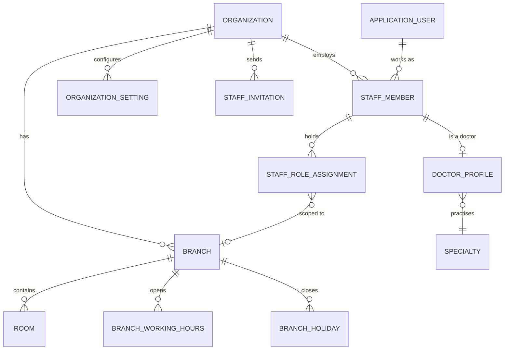

| Entity | Key fields | Notes |
|---|---|---|
| `Organization` | `Id`, `LegalName`, `BrandName`, `LogoUrl`, `TaxRegistrationNo`, `CommercialRegistrationNo`, `DefaultTimeZoneId`, `IsActive` | One row in V2 |
| `Branch` | `Id`, `OrganizationId`, `Code` (unique), `NameAr`, `NameEn`, `Address`, `City`, `Latitude`, `Longitude`, `Phone`, `TimeZoneId`, `IsActive` | `Code` appears in invoice numbers |
| `Room` | `Id`, `BranchId`, `NameAr`, `NameEn`, `Type` (`Consultation`, `Procedure`, `Triage`), `IsActive` | |
| `BranchWorkingHours` | `BranchId`, `DayOfWeek`, `OpensAt`, `ClosesAt` | Several rows per day allowed |
| `BranchHoliday` | `BranchId` (null = all branches), `StartDate`, `EndDate`, `Name`, `RecursYearly` | |
| `OrganizationSetting` | `OrganizationId`, `Key`, `Value` (JSON), `UpdatedBy`, `UpdatedAt` | Typed access via a settings service (FR-ORG-05) |
| `StaffMember` | `Id`, `OrganizationId`, `UserId`, `EmployeeNo`, `JobTitle`, `IsMedicalDirector`, `Status` (`Invited`, `Active`, `Inactive`), `StartDate`, `EndDate` | *V3 note:* unique on `(OrganizationId, UserId)` |
| `StaffRoleAssignment` | `StaffMemberId`, `Role`, `BranchId` (null = organization scope) | One row per role per branch |
| `StaffInvitation` | `Id`, `OrganizationId`, `Email`, `RolesJson`, `TokenHash`, `ExpiresAt`, `AcceptedAt`, `RevokedAt`, `InvitedBy` | Token stored hashed, like refresh tokens |
| `DoctorProfile` | V1 entity, now linked to `StaffMemberId`: `SpecialtyId`, `LicenseNo`, `BioAr?`, `BioEn?`, `YearsOfExperience`, `Languages`, `PhotoUrl`, `IsPublic`, `AverageRating`, `TotalReviews` | `ClinicAddress`, `ClinicCity`, `ConsultationFee`, `IsApprovedByAdmin` are retired ([§5](#5-v1-to-v2-mapping)) |
| `RolePermission` | `OrganizationId`, `Role`, `Permission`, `Scope` | Seeded from the default matrix ([02 §6](02_ROLES_AND_PERMISSIONS.md#6-role--permission-matrix)); editable (FR-STF-06) |

### 3.1a Recruitment

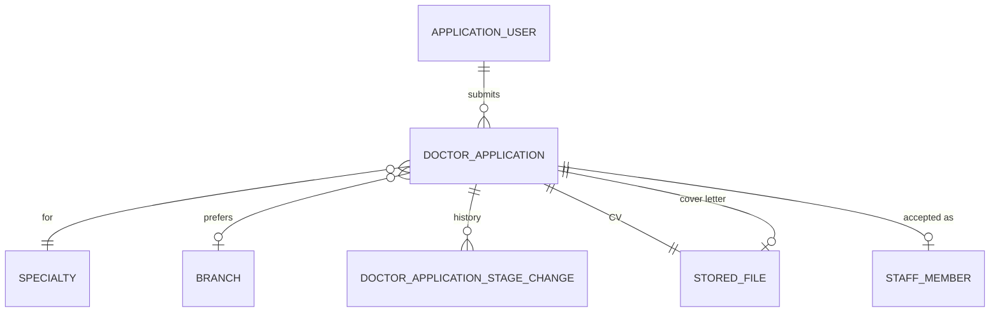

| Entity | Key fields | Notes |
|---|---|---|
| `DoctorApplication` | `Id`, `OrganizationId`, `UserId`, `SpecialtyId`, `PreferredBranchId?`, `LicenseNo`, `YearsOfExperience`, `Status`, `CvFileId`, `CoverLetterFileId?`, `CoverLetterText?`, `InterviewAt?` (UTC), `InterviewBranchId?`, `InterviewLocation?`, `InterviewerName?`, `StartDate?` (branch-local date), `AcceptedBranchId?`, `StaffMemberId?`, `FilesDeletedAt?`, `SubmittedAt`, `RowVersion` | Status values and transitions in [§4.6](#46-doctor-application). Stage methods on the entity (`ScheduleInterview(...)`, `Accept(...)`, `Reject(...)`, `Withdraw(...)`) validate the variables and return `Result` |
| `DoctorApplicationStageChange` | `Id`, `DoctorApplicationId`, `FromStatus`, `ToStatus`, `ChangedBy`, `ChangedAt`, `VariablesJson`, `MessageToApplicant?`, `OutboxMessageId?` | Append-only history; the variables are what the stage email was rendered from (FR-REC-03, FR-REC-04) |
| `StoredFile` | `Id`, `OrganizationId`, `OwnerType`, `OwnerId`, `FileName`, `ContentType`, `SizeBytes`, `StorageKey`, `Sha256`, `ScanStatus`, `UploadedBy`, `UploadedAt` | Shared by applications now and by clinical attachments and card images later ([06 §8](06_TECHNICAL_DESIGN.md#8-files-and-documents)) |

### 3.2 Catalog and scheduling

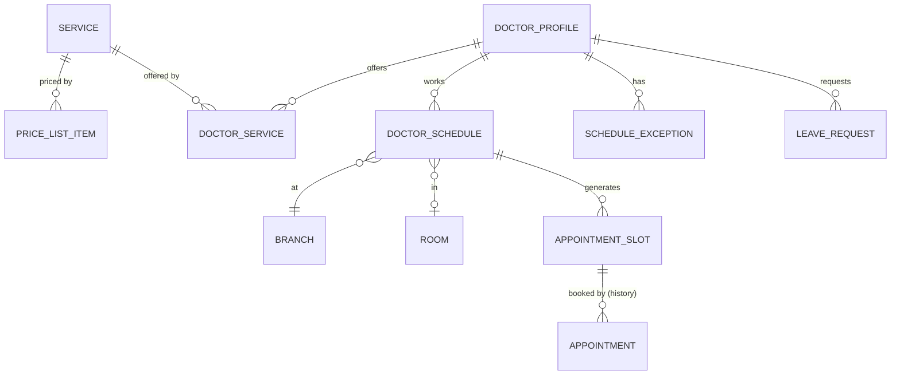

| Entity | Key fields | Notes |
|---|---|---|
| `Service` | `Id`, `OrganizationId`, `Code`, `NameAr`, `NameEn`, `Category` (`Consultation`, `FollowUp`, `Procedure`, `Package`), `DefaultDurationMinutes`, `SpecialtyId`, `OptionalDepositAmount?`, `IsActive` | A deposit is offered, never required (FR-APT-08) |
| `PriceListItem` | `Id`, `ServiceId`, `BranchId?`, `DoctorProfileId?`, `Price`, `ValidFrom`, `ValidTo?` | Most specific valid item wins (FR-SVC-02) |
| `DoctorService` | `DoctorProfileId`, `ServiceId`, `DurationMinutes?` | |
| `PayerServiceCode` | `PayerId`, `ServiceId`, `Code` | For claims (FR-SVC-05) |
| `DoctorSchedule` | V1 entity plus `BranchId`, `RoomId?`, `ValidFrom`, `ValidTo?`; several rows per weekday (shifts) | V1's "one per weekday" rule is removed (FR-SCH-01) |
| `ScheduleException` | `DoctorProfileId`, `BranchId`, `Date`, `StartTime`, `EndTime`, `Type` (`ExtraHours`, `Unavailable`), `Reason` | |
| `LeaveRequest` | `Id`, `DoctorProfileId`, `StartsAt`, `EndsAt` (branch-local), `Reason`, `Status` (`Requested`, `Approved`, `Rejected`, `Cancelled`), `DecidedBy`, `DecidedAt` | Approval creates the reschedule worklist |
| `AppointmentSlot` | V1 entity plus `BranchId`, `RoomId?`, `StartsAtUtc`, `EndsAtUtc`, `Capacity` (1 + overbook allowance), `BookedCount`, `BlockReason?` | Status stays `Available`/`Booked`/`Blocked`; unique on `(DoctorProfileId, Date, StartTime)` |

### 3.3 Patients and visits

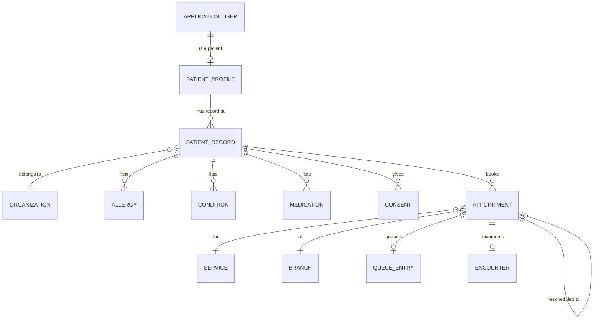

| Entity | Key fields | Notes |
|---|---|---|
| `PatientProfile` | V1 entity: global identity data only (name, phone and language via the user; gender, date of birth, national ID) | A desk-registered patient may have **no login yet**: `UserId` becomes nullable, and a portal invitation links it later |
| `PatientRecord` | `Id`, `OrganizationId`, `PatientProfileId`, `Mrn` (sequential per organization), `EmergencyContactName`, `EmergencyContactPhone`, `BloodType`, `MergedIntoId?`, `IsActive` | Clinical and organization-specific data. *V3 note:* one record per organization visited |
| `Allergy` / `Condition` / `Medication` | `PatientRecordId`, coded or free-text value, `Status`, `RecordedBy`, `RecordedAt` | Replace V1's free-text `Allergies` and `ChronicConditions` |
| `Consent` | `PatientRecordId`, `Type` (`Terms`, `DataProcessing`, `Treatment`), `Version`, `AcceptedAt`, `Channel` | FR-PAT-08 |
| `Appointment` | V1 entity plus `OrganizationId`, `BranchId`, `PatientRecordId` (replaces `PatientProfileId`), `ServiceId`, `RoomId?`, `Source` (`Online`, `Phone`, `Desk`, `WalkIn`), `CheckedInAt`, `StartedAt`, `CompletedAt`, `NoShowAt`, `RescheduledFromId?`, `RescheduledToId?`, `CancellationReasonCode`, `SlotId?` (null for unslotted walk-ins), `RowVersion` | `DoctorNotes` moves to `Encounter`; status values in [§4.1](#41-appointment) |
| `AppointmentSlotLink` | `AppointmentId`, `SlotId` | For services longer than one slot (FR-SCH-09) |
| `QueueEntry` | `AppointmentId`, `BranchId`, `DoctorProfileId`, `TicketNo` (per branch per day), `Stage` (`WaitingTriage`, `ReadyForDoctor`, `WithDoctor`, `Done`), `Position`, `RoomId?` | The queue is a projection of appointment state plus ordering |

### 3.4 Clinical

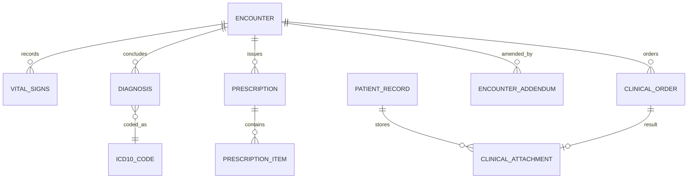

| Entity | Key fields | Notes |
|---|---|---|
| `Encounter` | `Id`, `OrganizationId`, `BranchId`, `AppointmentId`, `PatientRecordId`, `DoctorProfileId`, `Status` (`Draft`, `Signed`, `Voided`), `ChiefComplaint`, `Subjective`, `Objective`, `Assessment`, `Plan`, `TemplateId?`, `FollowUpInDays?`, `SignedAt`, `VoidReason`, `RowVersion` | Notes are encrypted at rest ([08 §3](08_SECURITY_PRIVACY_COMPLIANCE.md#3-data-protection)) |
| `VitalSigns` | `EncounterId`, `SystolicBp`, `DiastolicBp`, `Pulse`, `TemperatureC`, `RespiratoryRate`, `SpO2`, `WeightKg`, `HeightCm`, `PainScore`, `RecordedBy`, `RecordedAt` | Several sets per encounter allowed |
| `Diagnosis` | `EncounterId`, `Icd10Code`, `Description`, `IsPrimary`, `Status` (`Provisional`, `Confirmed`, `RuledOut`) | |
| `Icd10Code` | `Code`, `TitleEn`, `TitleAr?` | Global reference data |
| `Prescription` / `PrescriptionItem` | `EncounterId`, `SignedAt`, `VerificationCode`; items: `DrugName`, `DrugCatalogId?`, `Form`, `Dose`, `Route`, `Frequency`, `DurationDays`, `Quantity`, `Instructions`, `AllergyOverrideReason?` | Immutable once signed |
| `ClinicalOrder` | `EncounterId`, `Type` (`Lab`, `Radiology`, `Referral`), `Description`, `Status` (`Ordered`, `ResultReceived`, `Cancelled`), `ResultAttachmentId?` | |
| `ClinicalAttachment` | `Id`, `PatientRecordId`, `EncounterId?`, `Category`, `FileName`, `ContentType`, `SizeBytes`, `StorageKey`, `Sha256`, `UploadedBy`, `UploadedByPatient`, `ScanStatus` | File stored in blob storage ([06 §8](06_TECHNICAL_DESIGN.md#8-files-and-documents)) |
| `EncounterAddendum` | `EncounterId`, `Text`, `AuthorId`, `SignedAt` | |
| `EncounterTemplate` | `OrganizationId`, `SpecialtyId`, `Name`, `SectionsJson` | Managed by the medical director |

### 3.5 Billing

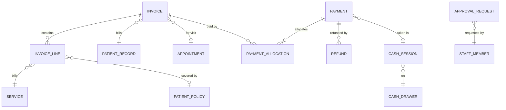

| Entity | Key fields | Notes |
|---|---|---|
| `Invoice` | `Id`, `OrganizationId`, `BranchId`, `Number` (`<BRANCH>-<YYYY>-<000001>`, set on issue), `PatientRecordId`, `AppointmentId?`, `Status`, `IssuedAt`, `Subtotal`, `DiscountTotal`, `PatientShareTotal`, `PayerShareTotal`, `PaidTotal`, `RefundedTotal`, `VoidReason`, `RowVersion` | Status values in [§4.3](#43-invoice) |
| `InvoiceLine` | `InvoiceId`, `ServiceId`, `Description`, `Quantity`, `UnitPrice`, `DiscountAmount`, `DiscountReason`, `PatientShare`, `PayerShare`, `PatientPolicyId?`, `PreAuthorizationId?`, `DoctorProfileId` | `PatientShare + PayerShare = Quantity × UnitPrice − DiscountAmount` |
| `InvoiceNumberSequence` | `BranchId`, `Year`, `LastNumber`, `RowVersion` | Incremented with a locking update in the issuing transaction (gapless) |
| `Payment` | `Id`, `OrganizationId`, `BranchId`, `PatientRecordId`, `AppointmentId?` (deposits), `Method` (`Cash`, `Card`, `BankTransfer`, `Online`, `Wallet`), `Amount`, `Reference`, `Gateway?` (`Paymob`), `GatewayTransactionId?`, `CashSessionId?`, `ReceivedBy`, `ReceivedAt`, `IdempotencyKey` | Desk payments carry the receptionist and their cash session; online ones the Paymob transaction id |
| `PaymentAllocation` | `PaymentId`, `InvoiceId`, `Amount` | One payment can settle several invoices; unallocated amount = patient credit |
| `Deposit` | modelled as a `Payment` (`Method = Online`, via Paymob) with an `AppointmentId`, allocated to the visit invoice when it exists | Optional; its presence never changes the appointment status (FR-APT-08, FR-BIL-14) |
| `Refund` | `Id`, `PaymentId`, `Amount`, `Reason`, `Status` (`Requested`, `Approved`, `Rejected`, `Paid`), `RequestedBy`, `ApprovedBy`, `PaidAt`, `CashSessionId?` | |
| `CashDrawer` | `Id`, `BranchId`, `Name`, `IsActive` | |
| `CashSession` | `Id`, `CashDrawerId`, `OpenedBy`, `OpenedAt`, `OpeningFloat`, `ClosedAt`, `CountedAmount`, `ExpectedAmount`, `Variance`, `Status` (`Open`, `Closed`, `Approved`), `ApprovedBy`, `Note` | |
| `ApprovalRequest` | `Id`, `OrganizationId`, `Type` (`Discount`, `Refund`, `InvoiceVoid`, `EncounterVoid`, `PatientMerge`, `CashVariance`, `ClaimWriteOff`), `SubjectId`, `Amount?`, `Reason`, `Status`, `RequestedBy`, `DecidedBy`, `DecidedAt` | One approvals inbox for all four-eyes rules ([02 §7](02_ROLES_AND_PERMISSIONS.md#7-approvals-four-eyes-rules)) |

### 3.6 Insurance

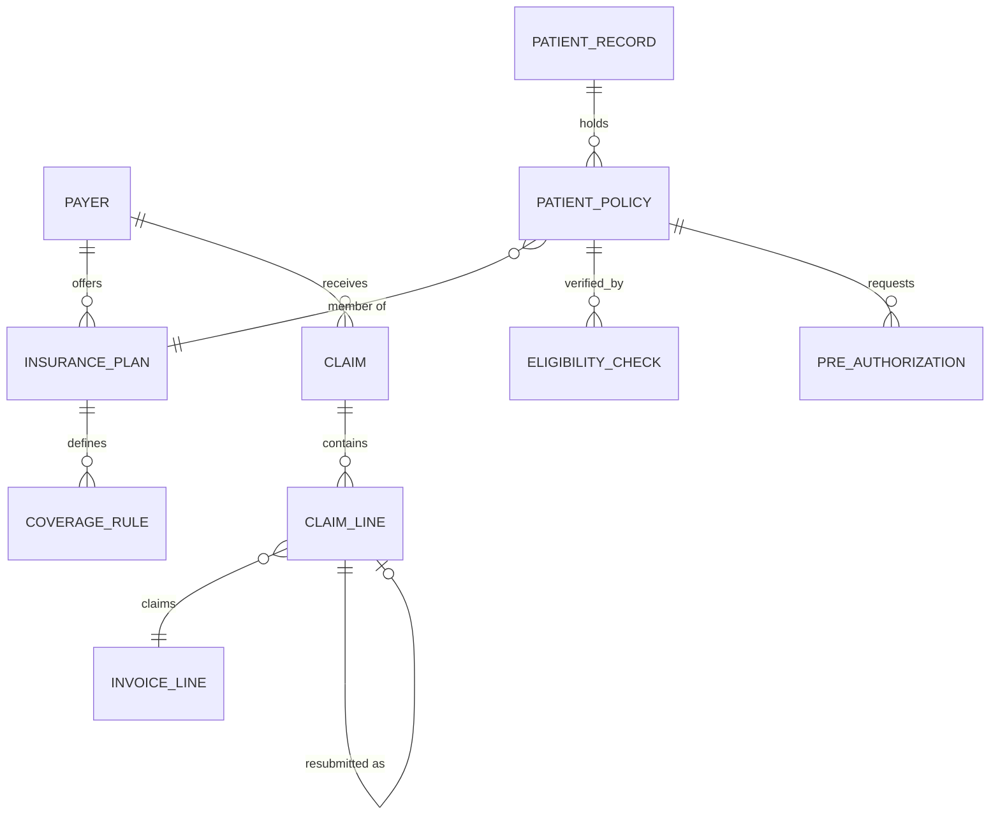

| Entity | Key fields | Notes |
|---|---|---|
| `Payer` | `Id`, `OrganizationId`, `Name`, `Type` (`Insurer`, `Tpa`), `Contact`, `ClaimFormat`, `SubmissionDeadlineDays`, `IsActive` | |
| `InsurancePlan` | `Id`, `PayerId`, `InsurerName?` (when the payer is a TPA), `Name`, `ValidFrom`, `ValidTo` | |
| `CoverageRule` | `PlanId`, `ServiceId?` or `ServiceCategory?`, `IsCovered`, `CoPayPercent?`, `CoPayFixed?`, `PerVisitCap?`, `AnnualLimit?`, `RequiresPreAuth`, `ValidFrom`, `ValidTo` | Most specific rule wins (service over category) |
| `PatientPolicy` | `Id`, `PatientRecordId`, `PlanId`, `MemberNo`, `HolderName`, `Relationship`, `ValidFrom`, `ValidTo`, `CardFrontAttachmentId`, `CardBackAttachmentId`, `IsDefault`, `IsActive` | |
| `EligibilityCheck` | `PatientPolicyId`, `CheckedAt`, `CheckedBy`, `Result` (`Eligible`, `NotEligible`, `Unknown`), `Reference`, `Note` | |
| `PreAuthorization` | `Id`, `PatientPolicyId`, `EncounterId?`, `ServiceId`, `DiagnosisCodes`, `RequestedAmount`, `Status` (`Requested`, `Approved`, `Rejected`, `Expired`, `Used`), `ApprovalNo`, `ApprovedAmount`, `ExpiresAt` | |
| `Claim` | `Id`, `OrganizationId`, `PayerId`, `PeriodFrom`, `PeriodTo`, `Status`, `SubmittedAt`, `SubmissionRef`, `TotalClaimed`, `TotalApproved`, `TotalPaid` | Status values in [§4.4](#44-claim) |
| `ClaimLine` | `ClaimId`, `InvoiceLineId`, `ClaimedAmount`, `ApprovedAmount`, `PaidAmount`, `Status` (`Pending`, `Approved`, `Rejected`, `Paid`, `WrittenOff`, `Resubmitted`), `RejectionReason`, `ResubmittedAsId?` | |
| `Remittance` | `Id`, `PayerId`, `ReceivedAt`, `Amount`, `Reference`, `AttachmentId?` | Allocated to claim lines |

### 3.7 Platform

| Entity | Key fields | Notes |
|---|---|---|
| `AuditEntry` | `Id`, `OrganizationId`, `OccurredAt`, `UserId`, `StaffMemberId?`, `Ip`, `Action` (`Create`, `Update`, `Delete`, `Read`, `Approve`, `BreakGlass`, `Export`), `EntityType`, `EntityId`, `PatientRecordId?`, `ChangesJson`, `Reason?`, `CorrelationId` | Append-only (FR-AUD-04) |
| `OutboxMessage` | `Id`, `OccurredAt`, `Type`, `PayloadJson`, `ProcessedAt?`, `Attempts`, `LastError` | [06 §5](06_TECHNICAL_DESIGN.md#5-domain-events-and-the-outbox) |
| `MessageDelivery` | `Id`, `OutboxMessageId`, `Channel`, `Recipient`, `TemplateKey`, `Status`, `ProviderMessageId`, `SentAt`, `Error` | FR-NTF-05 |
| `MessageTemplate` | `OrganizationId`, `Key`, `Channel`, `Language` (`ar`, `en`), `Subject?`, `Body`, `Placeholders` | FR-NTF-02; also the doctor-application stage emails (FR-REC-04) |
| `ApplicationUser` (V1) | Adds `PreferredLanguage` (`ar`, `en`), `NotificationChannel` (`Phone`, `Email`, `Both`; `Phone` = WhatsApp, or SMS when it is on); uses Identity's `PhoneNumber` (E.164) and `PhoneNumberConfirmed`; `Email` becomes optional for patients | FR-ACC-01…06, FR-NTF-04. Global, not organization-owned |
| `PhoneVerificationCode` | `Id`, `PhoneNumber`, `Purpose` (`SignUp`, `ChangePhone`, `PasswordReset`), `CodeHash`, `ExpiresAt`, `Attempts`, `ConsumedAt?`, `RequestIp`, `CreatedAt` | Global. Rows older than a day are purged (FR-ACC-02) |
| `Notification`, `RefreshToken`, `Review`, `Specialty` | V1 entities. `Notification` and `Review` gain `OrganizationId`; `Review` gains `BranchId` | `Specialty` stays global reference data |

## 4. State machines

Transitions are entity methods. Anything not drawn is illegal and returns `<Entity>.InvalidStatusTransition` (409).

### 4.1 Appointment

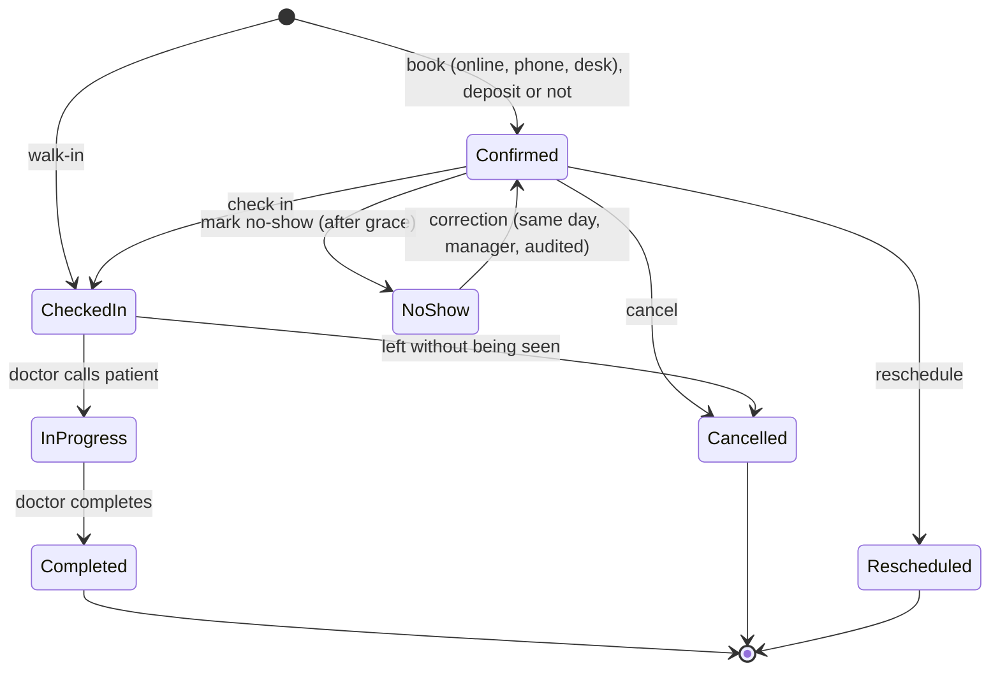

| Transition | Who (permission) | Guard |
|---|---|---|
| book → `Confirmed` | Patient, `appointments.book_on_behalf` | Slot `Available`, not in the past (branch time), patient has current consent and a verified phone, doctor offers the service. A deposit is optional and never changes the status |
| → `CheckedIn` | `appointments.check_in` | Appointment date is today (branch time), within the check-in window |
| `CheckedIn` → `InProgress` | Doctor (own), `queue.manage` | Doctor has no other appointment `InProgress` |
| `InProgress` → `Completed` | Doctor (own) | From P4 (EMR): an encounter exists (signing may follow within 24 h). Before P4: no guard |
| → `Cancelled` | Patient (window), doctor (own), `appointments.cancel` | Not `InProgress` or terminal |
| → `Rescheduled` | Patient (window), `appointments.reschedule` | New appointment created in the same transaction |
| `Confirmed` → `NoShow` | `appointments.mark_no_show` | Slot start + grace has passed |
| `NoShow` → `Confirmed` | Manager | Same day; audited correction |

V1 compatibility: `Pending` and `NoShow` already exist in the enum; `CheckedIn`, `InProgress` and `Rescheduled` are new values. V1 rows are `Confirmed`, `Cancelled` or `Completed` and stay valid. **`Pending` is not used by V2**: deposits are optional (decision 2026-10-22), so no booking waits for payment. The value stays in the enum so V1 data and clients keep working; it is reserved for a future confirmation step (FR-APT-10).

### 4.2 Encounter

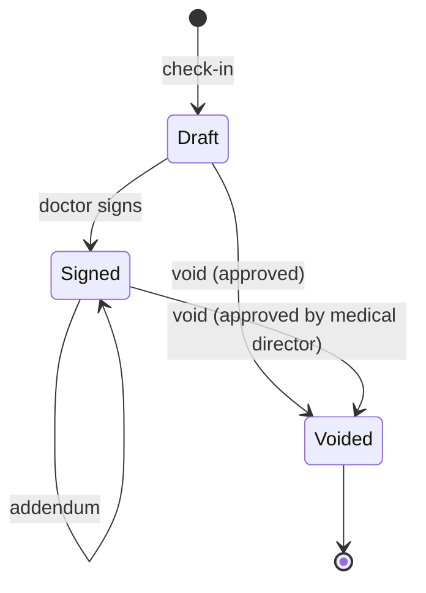

### 4.3 Invoice

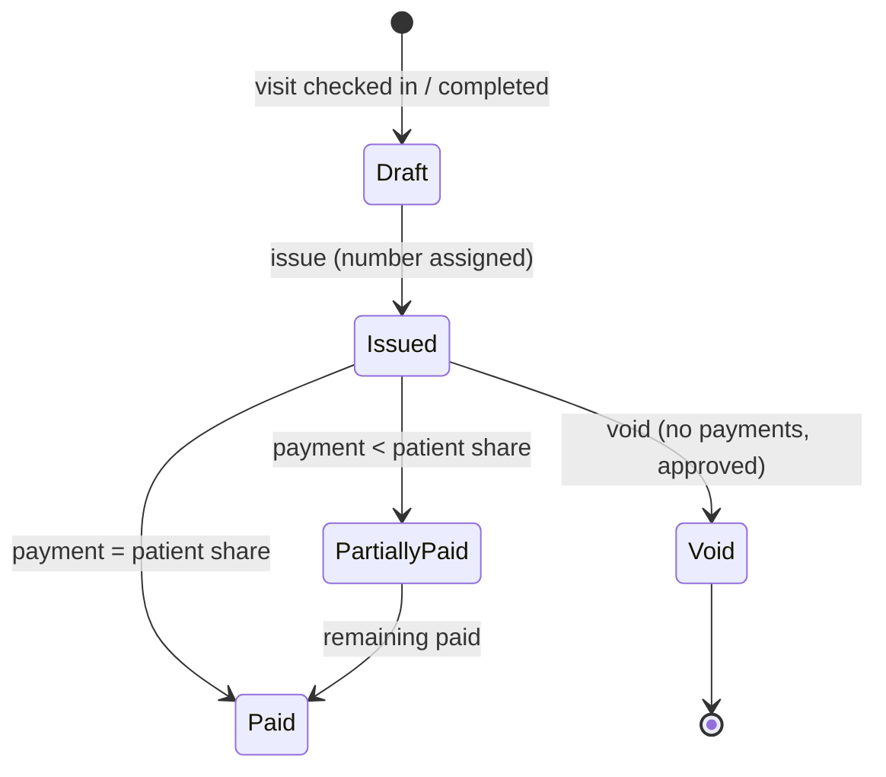

- A draft can be deleted (it has no number). An issued invoice is never deleted.
- `Paid` refers to the **patient share**. The payer share is tracked on claim lines and shown as a separate receivable.
- Refunds don't change the status; `RefundedTotal` and the derived balance show them.

### 4.4 Claim

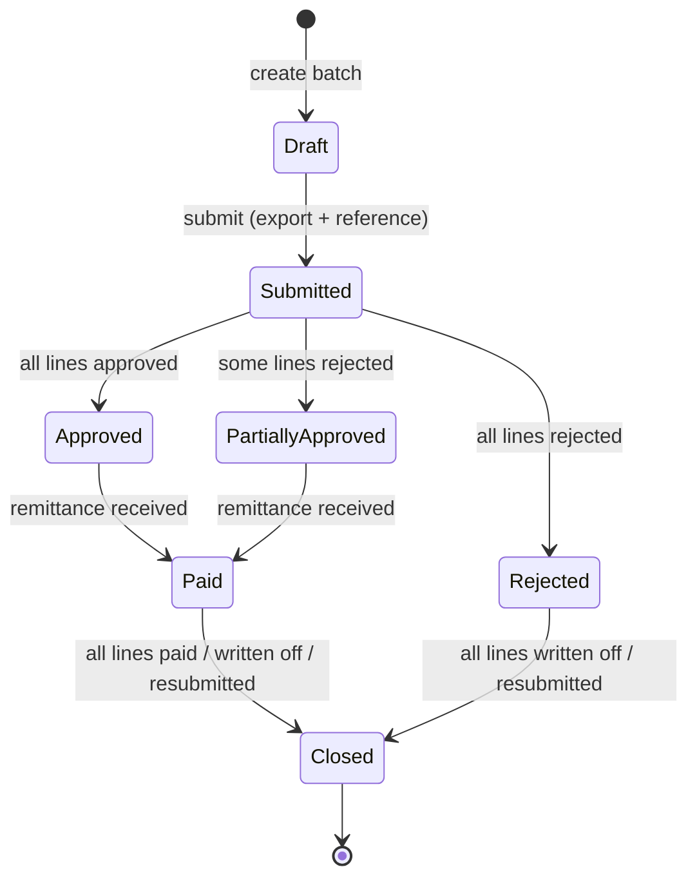

### 4.5 Pre-authorization and leave

| Entity | States |
|---|---|
| `PreAuthorization` | `Requested` → `Approved` → `Used` (linked to an invoice line) or `Expired`; `Requested` → `Rejected` |
| `LeaveRequest` | `Requested` → `Approved` / `Rejected`; `Requested`/`Approved` → `Cancelled` (before it starts) |
| `Refund` | `Requested` → `Approved` → `Paid`; `Requested` → `Rejected` |
| `CashSession` | `Open` → `Closed` → `Approved` |
| `StaffMember` | `Invited` → `Active` → `Inactive` (→ `Active` on rehire); from an accepted application: `Inactive` → `Active` on the start date |

### 4.6 Doctor application

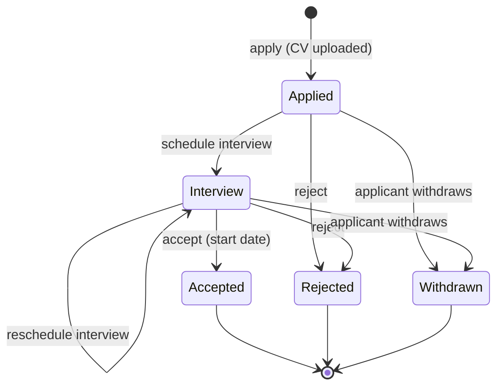

| Transition | Who (permission) | Required variables (FR-REC-03) | Guard |
|---|---|---|---|
| apply → `Applied` | The applicant (verified phone and email) | — | No other open application by the user; CV present and scanned clean |
| `Applied` → `Interview`, `Interview` → `Interview` | `recruitment.manage` | Interview date and time, branch or address, interviewer name; optional notes | Interview time in the future (branch time) |
| `Interview` → `Accepted` | `recruitment.manage` | Start date, branch; optional notes | Start date today or later; branch active; creates the staff member in the same transaction (FR-REC-05) |
| `Applied`/`Interview` → `Rejected` | `recruitment.manage` | Optional message | — |
| `Applied`/`Interview` → `Withdrawn` | The applicant | — | — |

Every transition writes a `DoctorApplicationStageChange` and raises `DoctorApplicationStageChanged`. The outbox renders and sends the stage email from it (FR-REC-04). Accepting directly from `Applied` is not allowed: the clinic always interviews.

## 5. V1 to V2 mapping

| V1 | V2 | Migration |
|---|---|---|
| `ApplicationUser` | Unchanged (global); MFA columns from Identity | — |
| `DoctorProfile.ClinicAddress`, `ClinicCity` | `Branch` | Branches created from distinct values ([09 §2](09_MIGRATION_FROM_V1.md#2-importing-v1-data)) |
| `DoctorProfile.ConsultationFee` | `PriceListItem` for the doctor's consultation service | One item per doctor |
| `DoctorProfile.IsApprovedByAdmin` | `StaffMember.Status` + `DoctorProfile.IsPublic`; `DoctorApplication` | Approved → `Active` staff + public; unapproved → a `DoctorApplication` in `Applied`, flagged "migrated from V1, no CV" |
| `ApplicationUser.Email` required; `PhoneNumber` stored but never verified | `Email` optional for patients; `PhoneNumber` normalised to E.164 and verified by a one-time code (WhatsApp or SMS) | V1 users keep their email; their phone is normalised, left unverified, and verified at the first V2 login |
| `PatientProfile.BloodType`, `Allergies`, `ChronicConditions`, emergency contact | `PatientRecord` + `Allergy` / `Condition` | Free text copied into one entry each, flagged "migrated" |
| `DoctorSchedule` (one per weekday) | `DoctorSchedule` with `BranchId`, several per weekday | `BranchId` from the doctor's branch |
| `AppointmentSlot` | + `BranchId`, `StartsAtUtc`, `EndsAtUtc`, `Capacity` | UTC computed with the branch time zone |
| `Appointment.PatientProfileId` | `Appointment.PatientRecordId` | Via the created records |
| `Appointment.DoctorNotes` | `Encounter.Plan` (signed, marked "migrated from V1") | One encounter per completed appointment with notes |
| `Review` | + `OrganizationId`, `BranchId` | From the appointment |
| Role strings in code | Role constants + permissions | [ADR 0002](adr/0002-permission-based-authorization.md) |

## 6. Invariants (must be enforced and tested)

1. A slot's `BookedCount` never exceeds `Capacity`; booking uses a conditional update (V1 pattern).
2. A doctor has at most one appointment `InProgress`, and no overlapping schedules across branches.
3. One encounter per appointment; a signed encounter's content never changes.
4. Invoice totals equal the sum of their lines; each line's shares sum to its net amount.
5. Invoice numbers per branch and year are unique and gapless.
6. A cash payment requires an open cash session of the receiving user.
7. Allocated payment amounts never exceed the payment amount; refunds never exceed the refundable amount.
8. A claim line references an invoice line with a payer share, at most once per active claim.
9. Every organization-owned row has the organization id of its parent.
10. Audit entries are never updated or deleted.
11. A user has at most one open (`Applied` or `Interview`) doctor application; an accepted application links to exactly one staff member.
12. A phone number belongs to at most one account, and only a verified phone can receive booking messages.
13. A deposit never changes an appointment's status; the deposit plus desk payments never exceed the invoice's patient share without becoming patient credit.
