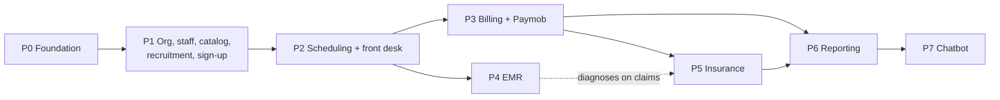

# 10: Roadmap

## 1. Phases at a glance

**V2 ships as releases (2026-10-29, [plans/R1.md](plans/R1.md)).** The phases below remain the catalog of work, but delivery is by release. Each release is a working product, backend and frontend, that a clinic can use:

| Release | Modules | Taken from |
|---|---|---|
| **R1 Clinic day** | Core (ORG, STF, ACC, SVC, SCH, APT, NTF, AUD, the dashboard, plans and modules) plus FD, triage, BIL at the desk (cash and card) and PAT booking | P1 without PRs 8, 11, 13, 14, 16, 17; P2; P3 without Paymob |
| R2 Clinical | EMR, REC, staff MFA, file storage, Paymob deposits | P1 PRs 8, 11, 13, 14; P3 Paymob; P4 |
| R3 Insurance and reports | INS, RPT exports, finance screens, editable role permissions | P5, P6, P1 PR 16 |
| R4 Platform and bot | Operator console, subscription billing, BOT | Platform phase (ADR 0008), P7 |

| Phase | Goal | Relative size | Depends on | Ships in |
|---|---|---|---|---|
| P0 Foundation | Fix what V2 builds on; cross-cutting pieces | M | — | Done |
| P1 Organization, staff, catalog, recruitment, sign-up | The clinic, its people and prices exist; doctors apply; patients sign up by mobile | L | P0 | R1 (recruitment, MFA, files: R2; role editing: R3) |
| P2 Scheduling 2.0 and front desk | One calendar and a live waiting room; WhatsApp/email reminders; the admin dashboard | L | P1 | R1 |
| P3 Billing and payments | The receptionist takes the money; optional Paymob deposits | L | P2 | R1 (Paymob: R2) |
| P4 Clinical records (EMR) | Every visit has a structured, signed record | L | P2 | R2 |
| P5 Insurance | Insurance visits are split and claims get paid | M | P3, P4 | R3 |
| P6 Reporting | Reports and exports beyond the dashboard; V3 groundwork | S | P3, P5 | R3 |
| P7 Chatbot | A bilingual patient assistant | S | P6 | R4 |

**Sizes, not dates.** V2 is built by **one developer working with Claude** on both repos (backend and frontend). Sizes are relative (S < M < L) and only for sequencing; each phase is estimated in weeks at its kickoff, and the estimate is recorded in the decisions log (§6). A phase can start its backend while the frontend of the previous one finishes, as long as the previous phase's exit criteria are met first.

**V2 is a separate product line** ([ADR 0007](adr/0007-v2-separate-product-line.md)):
- V2 is built on the `v2` branch of both repos, with its own database. V1 stays on `master`/`main`, untouched.
- The owner decides if and when V2 replaces V1.
- Exit criteria that mention a **pilot branch** or real clinic data apply only once the owner chooses to pilot V2. Until then they are checked in a V2 staging environment with demo data (and a test import of V1 data, [09 §2](09_MIGRATION_FROM_V1.md#2-importing-v1-data)).

**Order changed on 2026-10-22:** billing (now P3) comes **before** EMR (now P4). Taking money at the desk is part of every visit in the clinic, while EMR needs legal sign-off first (R2). The two phases share only the appointment and the patient record.

Each phase ends with a **phase review**: exit criteria met, docs updated (`API_CONTRACT.md` 4.x, `PROJECT_OVERVIEW.md`, REVIEW entries), pilot feedback recorded (if piloted), next phase re-planned and estimated. Since 2026-10-29 a finished **release** is tagged `v2.0.0-r<n>` on the `v2` branch of both repos (P0 kept its `v2.0.0-p0`); `v2.0.0` is tagged at V2 general availability.

## 2. Phases

### P0: Foundation

**Status:** done 2026-10-24 (tag `v2.0.0-p0`; [plans/P0.md](plans/P0.md)).

**Goal:** fix what V2 would otherwise build on top of, and lay the cross-cutting pieces.

**Already delivered by V1** (finished 2026-10-18, contract 3.1.2; see [09 §5](09_MIGRATION_FROM_V1.md#5-where-each-v1-issue-is-resolved)), so P0 no longer includes:

| Area | Delivered in V1 |
|---|---|
| Errors and shapes | Global exception handler and ProblemDetails for every error (M5, NL9); corrected error catalog (M3); paging with `X-Total-Count` (H6, NL2) |
| Authorization | Fallback policy and the explicit-attribute test (NM5) |
| Time | One configured clinic time zone with `IDateTimeProvider.ClinicNow` (M2 for one zone) |
| Scheduling | `SlotGenerationJob` rolling 14-day window (H8); safe schedule edits (H4) |
| Ops | `/health` (M12); per-IP rate limit on auth endpoints and login lockout (M6); least-privilege `clinicflow_app` login in compose (NM6); demo seeding gated by `Seeding:DemoData` |

**Remaining P0 work:**

| Area | Deliverables | Resolves |
|---|---|---|
| **Separation from V1 (first)** | Before any V2 migration: a new `UserSecretsId`; database name `ClinicFlowV2` in every connection string, compose file and `db-init` script; a distinct compose project name, container names and host ports; a check at startup that refuses to run V2 migrations against a database that has V1's migration history but no V2 marker | [ADR 0007](adr/0007-v2-separate-product-line.md) |
| Architecture | `Infrastructure` project (email moved out of `Services`); drop `Services → Persistence` behind `ITransaction`; module folders for new code; architecture tests (AutoMapper stays; its replacement is deferred, Q17) | §4.6, [ADR 0006](adr/0006-clean-architecture-modular-monolith.md) |
| Authorization | Permission constants, `IAccessGuard`, `ICurrentUser`, `[HasPermission]`, anonymous-endpoint allowlist in the existing test | NL10, §4.7 |
| Tenancy | `Organization`, `OrganizationId` backfill, global query filters, tenant interceptor, model test | [ADR 0001](adr/0001-single-organization-tenant-ready.md) |
| Time | `Branch` with time zone (one default branch), `IClock` replacing `IDateTimeProvider`, `StartsAtUtc` on slots, ban on `DateTime.UtcNow` | §4.1, FR-ORG-06 |
| State | Appointment state machine in the entity, with the new statuses | §4.3, FR-APT-01 |
| Events | Domain events, outbox, dispatcher; existing notifications and emails moved onto it | NM3, NL6, §4.4 |
| Audit | `AuditEntry` interceptor, append-only permissions | FR-AUD-01, FR-AUD-04 |
| Ops | `/health/live` and `/health/ready`, migration bundle for Docker and production (automatic migration at startup stays for Development and tests only), deploy login, SQL retry strategy, CI pipeline (build, tests, openapi diff, vulnerable packages) | M12, NM6, NL14, §4.9, §4.10 |

**FRs:** FR-ORG-06, FR-APT-01, FR-AUD-01, FR-AUD-04, and the platform parts of NFR-01…NFR-12.
**Exit criteria:** the inherited V1 tests pass on the `v2` branch against the V2 database; `master` (V1) unchanged; CI green on `v2`; architecture, permission and tenancy tests in place; the outbox delivers V1 notifications.

### P1: Organization, staff, catalog, recruitment and sign-up

**Goal:** the clinic exists in the system with its branches, people and price list; doctors join by application; patients sign up with a mobile number.

**FRs:** FR-ORG-01…05, FR-STF-01…09, FR-SVC-01…03, FR-REC-01…08, FR-ACC-01…06, FR-NTF-01 (phone channels), FR-NTF-02, FR-AUD-03.
**Deliverables:**
- branches, rooms, working hours, holidays; staff invitations, roles, scopes, MFA, deactivation; doctor profiles; service catalog and price list; audit viewer
- **phone channels** behind `IMessageChannel` ([06 §9.2](06_TECHNICAL_DESIGN.md#92-whatsapp-and-sms-phone-channels)): the WhatsApp and SMS adapters, both switched off until their providers are ready, and a log channel for Development and tests; **sign-up by mobile number** with one-time codes (WhatsApp first, SMS when on); login by phone or email; password reset by code; preferred language; AR/EN message templates (V1's emails rewritten)
- **file storage** with virus scanning (moved here from the EMR phase)
- **doctor recruitment**: applications with CV and cover letter, the Applied → Interview → Accepted pipeline, stage emails with the reviewer's variables and a preview, staff activation on the start date
- import-tool steps 3–5 and 4a ([09 §2](09_MIGRATION_FROM_V1.md#2-importing-v1-data)); the inherited doctor registration and approval routes deleted from `v2`

**Exit criteria:** the clinic's real branches, staff and prices are entered in staging; every role can log in with MFA and sees only its menus; a test applicant goes from application to an active doctor with all four emails in both languages; a patient signs up with only a phone number; the permission matrix test passes for all P1 permissions.

### P2: Scheduling 2.0 and front desk

**Goal:** one calendar for every booking, a live waiting room, and the first dashboard.

**FRs:** FR-SCH-01…10, FR-APT-02…07, FR-APT-09, FR-APT-10, FR-FD-01…06, FR-FD-08, FR-NTF-03…06, FR-SVC-04, FR-RPT-01 (operational part), FR-RPT-04, FR-RPT-11 (charts 1, 2, 4), FR-PAT-01, FR-PAT-02, FR-PAT-08, FR-PAT-09.
**Deliverables:** schedules per branch with shifts, rooms, exceptions, leave and the reschedule worklist; rolling slot generation per branch; booking on behalf, walk-ins, check-in, **triage vitals keyed by appointment** (moved from P4, 2026-10-27), queue board with SignalR, waiting-room display; reschedule and no-show; **booking confirmations and reminders by phone (WhatsApp, or SMS when on), email or both, as the patient chooses**; patient registration with duplicate detection; portal booking by branch and service with prices; consent capture; **admin dashboard** with KPI tiles and three of the four charts; import-tool steps 6–9.
**Exit criteria:** the pilot branch runs all bookings (online, phone, walk-in) in ClinicFlow for two weeks; zero double bookings; the queue board is used by desk, nurses and doctors; no-show rate measured and shown on the dashboard.

### P3: Billing and payments

**Goal:** every visit is billed, the receptionist takes the money, and every pound is reconciled. Works without an accountant.

**FRs:** FR-BIL-01…03, FR-BIL-05…15, FR-APT-08, FR-FD-07, FR-SVC-06, FR-RPT-05, FR-RPT-06, FR-RPT-07, FR-RPT-11 (chart 3), FR-PAT-03, FR-PAT-04.
**Deliverables:** invoices from visits (from the booked service and manual lines until EMR ships); **desk checkout by the receptionist** (amount due minus any deposit, cash or card, receipt); discounts with approvals; refunds; cash sessions; branch numbering; daily close by the manager; **optional Paymob deposits** (hosted checkout, HMAC-verified webhook, refunds) and online payment of open invoices; no-show fees; patient balances and statements; approvals inbox; the revenue chart.
**Exit criteria:** penetration test of the payment flows passed; the pilot branch closes every day in ClinicFlow for two weeks with recorded variances and **no accountant involved**; 100% of completed visits invoiced; a Paymob sandbox and then a live deposit is received, deducted at the desk and refunded once; the manager signs off the daily close report against the POS terminal and the Paymob settlement.

### P4: Clinical records (EMR)

**Goal:** every visit has a structured, signed record.

**FRs:** FR-EMR-01…15, FR-APT-11, FR-RPT-09, FR-AUD-02, FR-PAT-05, FR-PAT-06.
**Deliverables:** encounters (taking over P2's triage vitals), SOAP templates, ICD-10, prescriptions with allergy checks and PDFs, orders, clinical attachments (on P1's file storage), signing and addenda, voids, history timeline, patient visit summaries, read logging, break-glass; the "encounter exists" guard on completing a visit; import-tool step 10.
**Exit criteria:** penetration test passed; privacy checklist items P1, P3, P4 done ([08 §5](08_SECURITY_PRIVACY_COMPLIANCE.md#5-privacy-and-consent)); ≥ 90% of pilot visits have a signed encounter within 24 h; doctors' documentation time measured and accepted by the medical director.

### P5: Insurance

**Goal:** insurance visits are split correctly and claims get paid.

**FRs:** FR-INS-01…12, FR-BIL-04, FR-SVC-05, FR-RPT-08.
**Deliverables:** payers, plans, coverage rules, policies with cards, eligibility recording, pre-authorizations, automatic split, claim batches with validation, exports per payer, remittances, denials and resubmission, aging.
**Exit criteria:** the clinic's top three payers configured; one full monthly claim cycle run from ClinicFlow; claim rejection rate baseline recorded. **V2 general availability** (when the owner chooses V2): V1 data imported ([09 §2](09_MIGRATION_FROM_V1.md#2-importing-v1-data)), all branches on V2, inherited unversioned routes deleted from `v2` ([09 §3](09_MIGRATION_FROM_V1.md#3-the-api-on-the-v2-branch)), and `v2` merged into `master`/`main` with V1 kept on `release/v1` ([ADR 0007](adr/0007-v2-separate-product-line.md)).

### P6: Reporting and V3 groundwork

**Goal:** managers decide from data; the platform is ready for more organizations.

**FRs:** FR-RPT-02, FR-RPT-03, FR-RPT-10, FR-APT-12, FR-PAT-07.
**Deliverables:** reporting tables, report pages and exports (the dashboard stays at four charts), waitlist, dependants; V3 readiness review (tenant resolution by host, platform-operator role design, organization onboarding flow, per-organization settings and branding).
**Exit criteria:** success metrics of [01 §3](01_VISION_AND_SCOPE.md#3-goals) reported monthly; V3 readiness review signed off.

### P7: Chatbot

**Goal:** patients get quick answers and find slots by chatting, in Arabic or English.

**FRs:** FR-BOT-01.
**Deliverables:** scope and provider decided (Q16); the assistant in the patient portal, grounded in clinic data and an approved FAQ, booking through the normal booking endpoint ([06 §9.5](06_TECHNICAL_DESIGN.md#95-chatbot-p7)).
**Exit criteria:** answers checked against a test set of common questions in both languages; no medical advice in a red-team test; cost per conversation measured and within the agreed cap.

### Not in V2

FR-BIL-16 (e-receipt integration) and FR-INS-13 (electronic payer integration) are *Won't* for V2 and revisited after GA, depending on the open questions below. WhatsApp is no longer deferred: since 2026-10-26 it is the intended primary phone channel (FR-NTF-01).

## 3. Dependencies

External dependencies:
- **P0:** hosting and storage decisions.
- **Before launch** (not blocking P1, which builds against the log channel): Meta business verification and approved WhatsApp templates (AR/EN), and an SMS provider with sender-name approval if SMS is switched on.
- **P3:** a Paymob merchant account (contract, sandbox, then live keys); start onboarding during P2.
- **P4:** legal sign-off on the privacy checklist before go-live.
- **P5:** payer claim formats.
- **P7:** an LLM provider and its data terms.

## 4. Risks

| # | Risk | Likelihood | Impact | Mitigation | Owner |
|---|---|---|---|---|---|
| R1 | Scope is too large for **one developer**; phases slip | High | High | Strict MoSCoW; *Should*/*Could* items move to the next phase rather than delay a phase; each phase estimated at kickoff; Claude used for routine code, tests and docs; phase reviews re-plan | Developer + product owner |
| R2 | Legal requirements (licence, hosting location, retention) delay the EMR go-live | Medium | High | Start legal review in P0; hosting decision before P1; EMR moved to P4 so billing ships first | Clinic management |
| R3 | Free-text doctor addresses don't map cleanly to branches | High | Low | Manual branch mapping sheet ([09 §2](09_MIGRATION_FROM_V1.md#2-importing-v1-data)) | Developer |
| R4 | The frontend (separate repo, same developer) lags behind the backend | Medium | High | Each phase's exit criteria include its frontend track; API-first with mocks from `openapi.json`; backend of the next phase starts only after the current frontend is usable | Developer |
| R5 | Staff resistance; front desk falls back to paper | Medium | High | Pilot branch, super-users, training sandbox, measure adoption weekly, fix friction quickly | Branch managers |
| R6 | Insurer formats differ and change | High | Medium | Configurable export templates per payer; start with the top three payers | Developer + clinic |
| R7 | Paymob onboarding takes longer than expected | Medium | Medium | Start the merchant application in P2; P3 can go live with desk payments only (cash and POS) and add online deposits later, because deposits are optional | Clinic management |
| R8 | Internet outage at a branch stops the front desk | Medium | High | Offline is out of scope; mitigate with a backup 4G link and a printed day list exported each morning; revisit offline support if outages are frequent | IT |
| R9 | A security incident exposes medical data | Low | Very high | [08](08_SECURITY_PRIVACY_COMPLIANCE.md) controls, pen tests before P3/P4, audit and alerts, incident runbook | IT + DPO |
| R10 | Real-time queue doesn't scale with more instances | Low | Medium | Single instance at first; SignalR backplane when scaling | Developer |
| R11 | Doctors find structured notes slower than free text | Medium | Medium | Specialty templates, free-text sections allowed, measure documentation time in the pilot | Medical director |
| R12 | Phone-message cost or abuse (code pumping) grows; Meta's verification or template approval delays WhatsApp; some patients have no WhatsApp | Medium | Medium | Caps, cooldowns and a spend alert ([08 §2](08_SECURITY_PRIVACY_COMPLIANCE.md#2-threats-and-controls)); the WhatsApp Business account registered in Egypt (the international authentication rate is about 18× higher); Meta verification started at P1's kickoff; SMS kept built and switched on as the fallback if needed; email as a fallback channel when the patient has one; delivery receipts | Developer |
| R13 | The chatbot gives wrong or unsafe answers | Medium | Medium | Built last; grounded in clinic data only; no medical advice; red-team test before launch | Developer + medical director |
| R14 | V1 and V2 drift apart; a V1 fix is forgotten in V2, or the import tool falls behind V2's schema | Medium | Medium | Every V1 fix on `master` is checked for `v2` and cherry-picked the same day; the import tool has a test per step run in CI against a V1 sample database, so a V2 schema change that breaks it fails the build | Developer |

## 5. Open questions

Each needs an owner and a decision date at the phase where it's needed.

| # | Question | Needed by | Options / notes |
|---|---|---|---|
| Q1 | ~~Which payment gateway?~~ | — | **Decided 2026-10-22: Paymob** (hosted checkout, cards and wallets) |
| Q2 | Which **WhatsApp** provider, and which SMS provider for when SMS is switched on? | **Before launch** (P1 is built against the log channel, so it doesn't block P1) | **WhatsApp** (decided 2026-10-26 as the intended primary): Meta's Cloud API directly, or a business solution provider (BSP) for its support and dashboard at a mark-up; register under the Egyptian business. **SMS** (built, switched off): a local Egyptian aggregator vs an international one (Twilio, Vonage); compare price per Arabic segment, delivery on Egyptian networks and sender-name registration time |
| Q3 | Where is the system hosted, and may data leave Egypt? | P0 | Depends on the legal answer (08 P6); affects storage and provider choices |
| Q4 | Is the clinic in scope of the Egyptian Tax Authority e-receipt / e-invoice system? | P3 | If yes, FR-BIL-16 becomes *Must* and P3 grows |
| Q5 | Which insurers / TPAs does the clinic work with, and what are their claim formats and deadlines? | P5 | Collect sample files from the clinic |
| Q6 | Does the clinic participate in the Universal Health Insurance system? | P5 | Would require a separate integration project |
| Q7 | Drug catalog source for prescriptions? | P4 | Free text only, a licensed Egyptian drug database, or a clinic-maintained list |
| Q8 | Deposit policy? | P3 | **Partly decided 2026-10-22:** deposits are optional and never block a booking. Still open: the amount per service, and whether a cancelled deposit is refunded or kept (and the no-show fee) |
| Q9 | May doctors edit their own schedules, or only request changes? | P2 | Setting exists; the default needs a decision |
| Q10 | Retention periods for clinical and financial records, and for rejected applicants' CVs? | P1 (CVs), P4 | Legal answer (08 §6); CV default 6 months |
| Q11 | Who are the medical director(s) and the DPO? | P1 | Needed for approvals and privacy duties. (Who reviews doctor applications is decided: holders of `recruitment.manage`, Managers by default) |
| Q12 | Keep `BackgroundService` jobs or adopt Hangfire? | P2 | Decide when jobs need retries and dashboards |
| Q13 | PDF library: QuestPDF licence vs HTML → PDF? | P3 | Receipts need it first now; depends on the clinic's revenue tier and Arabic rendering tests |
| Q14 | Waiting-room display hardware? | P2 | Smart TV browser vs small PC per branch |
| Q15 | Doctor revenue share: report only, or calculate payouts? | P6 | V2 reports revenue per doctor; payouts are out of scope unless decided |
| Q16 | Chatbot scope, LLM provider and data rules? | P7 | FAQ only vs FAQ + booking; e.g. the Claude API; what patient data may be sent (legal); cost cap |
| Q17 | Keep AutoMapper (licence) or replace it with explicit mapping? | Before V2 goes to production | Deferred on 2026-10-23; mapping stays isolated in per-module profiles so the replacement is a contained refactor |

## 6. Decisions log

| Date | Decision | Record |
|---|---|---|
| 2026-10-09 | V2 = one organization with branches, tenant-ready for V3 | [ADR 0001](adr/0001-single-organization-tenant-ready.md) |
| 2026-10-09 | Roles: Admin, Manager, Receptionist, Nurse, Doctor, Accountant, Patient; permission-based authorization | [ADR 0002](adr/0002-permission-based-authorization.md) |
| 2026-10-09 | Branch time zones; slots store local time + UTC | [ADR 0003](adr/0003-branch-time-zones.md) |
| 2026-10-09 | Appointment state machine in the entity | [ADR 0004](adr/0004-appointment-state-machine.md) |
| 2026-10-09 | `/api/v2` prefix; V1 frozen then removed | [ADR 0005](adr/0005-api-v2-versioning.md) |
| 2026-10-09 | Modules in V2: EMR, billing and payments, insurance; inventory out of scope | [01 §4](01_VISION_AND_SCOPE.md#4-scope) |
| 2026-10-22 | V2 is **contract 4.0.0** (V1 used 2.0.0 and is at 3.1.2) | [ADR 0005](adr/0005-api-v2-versioning.md) (amended) |
| 2026-10-22 | Lists keep V1's shape: JSON array + `X-Total-Count`; no `PagedResponse<T>` envelope | [07 §3](07_API_DESIGN.md#3-conventions) |
| 2026-10-22 | One developer; phases sized S/M/L and estimated at kickoff; no calendar dates | §1 |
| 2026-10-22 | Doctors join by **application** (CV, optional cover letter; Applied → Interview → Accepted, with stage emails); reviewing is the `recruitment.*` permission, Manager by default; no HR role | [04 §4.14](04_FUNCTIONAL_REQUIREMENTS.md#414-recruitment-rec) |
| 2026-10-22 | Patients sign up with a **mobile number verified by SMS**; email optional; login with phone or email | [04 §4.15](04_FUNCTIONAL_REQUIREMENTS.md#415-accounts-and-sign-in-acc) |
| 2026-10-22 | Patients choose **SMS, email or both** for confirmations and reminders; every message in the user's language (Arabic default) | FR-NTF-04, R10 |
| 2026-10-22 | Payment gateway: **Paymob**; deposits are **optional**, a booking is confirmed without one; the **receptionist** collects at the desk; billing works without an accountant | FR-APT-08, FR-BIL-05, FR-BIL-06 |
| 2026-10-22 | Billing (P3) before EMR (P4) | §1 |
| 2026-10-22 | Admin dashboard: KPI tiles and at most four charts | FR-RPT-11 |
| 2026-10-22 | Chatbot is the last phase (P7) | FR-BOT-01 |
| 2026-10-22 | Keep Clean Architecture as a modular monolith; SOLID rules enforced by architecture tests; **CQRS-lite** (separate command and query services, no MediatR, one database); patterns adopted on merit, for new code and enhancements; no microservices or event sourcing | [ADR 0006](adr/0006-clean-architecture-modular-monolith.md) |
| 2026-10-22 | Every finished or changed service ships with unit tests for its methods, plus integration tests where HTTP behaviour matters | [06 §2.1](06_TECHNICAL_DESIGN.md#21-design-principles), CLAUDE.md |
| 2026-10-22 | **V2 is a separate product line:** `v2` branch in both repos, its own database (`ClinicFlowV2`); V1 on `master`/`main` stays untouched; the owner decides if and when to switch, using a one-time import tool. Supersedes ADR 0005 decisions 2–5 | [ADR 0007](adr/0007-v2-separate-product-line.md) |
| 2026-10-23 | P0 plan agreed ([plans/P0.md](plans/P0.md)): automatic migration at startup only in Development and tests; AutoMapper kept for now (Q17); the `v2` contract doc starts a pre-release "4.0.0-p0" changelog in P0; the outbox delivers in-app notifications too (about 2 s delay) | [plans/P0.md](plans/P0.md) |
| 2026-10-23 | **Transactions retry on transient SQL errors** (P0 PR 3): one runner, `IUnitOfWork.ExecuteInTransactionAsync`, inside EF's execution strategy; it rewinds the change tracker between attempts and never retries after a commit. Side effects stay outside transactions until the outbox. Layer rules are enforced by metadata-reading architecture tests; Presentation may use Domain enums only | [06 §2](06_TECHNICAL_DESIGN.md#2-solution-structure), [06 §10](06_TECHNICAL_DESIGN.md#10-data-access-and-performance), [plans/P0.md](plans/P0.md) |
| 2026-10-23 | **One clock, UTC everywhere** (P0 PR 4): `IClock` replaces `IDateTimeProvider` under the new name (amends ADR 0003, which had it extend the old interface) and wraps .NET's `TimeProvider`. A source-scanning test bans every other read of the system clock in production code. Every `DateTime` column is UTC and read back as UTC, so API timestamps end in `Z` (contract 4.0.0-p0) | [ADR 0003](adr/0003-branch-time-zones.md), [06 §6](06_TECHNICAL_DESIGN.md#6-time-and-time-zones), [plans/P0.md](plans/P0.md) |
| 2026-10-23 | **Tenancy in the schema** (P0 PR 5): one organization and one `MAIN` branch, inserted by the migration that backfills existing rows. Organization ownership is a marker interface; `ClinicDbContext` adds the query filter and foreign keys to every type that has it, and a save interceptor stamps and checks `OrganizationId`. A second organization is seeded in integration tests to prove isolation | [ADR 0001](adr/0001-single-organization-tenant-ready.md), [06 §4](06_TECHNICAL_DESIGN.md#4-tenancy), [plans/P0.md](plans/P0.md) |
| 2026-10-23 | **Slots carry UTC instants** (P0 PR 6): `StartsAtUtc` / `EndsAtUtc` next to the branch-local date and times; every "now" rule compares the UTC start. One conversion rule (`Domain.Time.WallClock`) for daylight saving: a skipped time gets no slot, a repeated time is its first occurrence. `IClock`'s branch members take the zone id (ADR 0003 amended) | [ADR 0003](adr/0003-branch-time-zones.md), [06 §6](06_TECHNICAL_DESIGN.md#6-time-and-time-zones), [plans/P0.md](plans/P0.md) |
| 2026-10-23 | **Appointment state machine and CQRS-lite** (P0 PR 7): `Appointment` owns its status (private setter, one method per transition returning `Result`; new statuses `CheckedIn`, `InProgress`, `Rescheduled`). The Result pattern moved into `Domain` so entities can return it, and `Presentation` may use it. Appointments are the first CQRS-lite module: booking, cancellation and visit command services, and `AppointmentQueries` in Persistence (registered in DI; `QueryClassTests` proves it never writes) | [ADR 0004](adr/0004-appointment-state-machine.md), [ADR 0006](adr/0006-clean-architecture-modular-monolith.md) |
| 2026-10-23 | **Permissions in code, checked against the document** (P0 PR 8): the 02 §5 catalog and §6 default matrix are constants (`Shared/Authorization`), and a test compares them with the document cell by cell. `[HasPermission]` with a dynamic policy provider; `IAccessGuard` answers with `bool` so services keep their error codes; `ICurrentUser` over the HTTP context. The anonymous endpoints are an explicit allowlist | [ADR 0002](adr/0002-permission-based-authorization.md), [06 §3](06_TECHNICAL_DESIGN.md#3-authorization), [plans/P0.md](plans/P0.md) |
| 2026-10-24 | **Transactional outbox for every notification and email** (P0 PR 9): domain events saved as `OutboxMessage` rows in the change's transaction, one handler per event, at-least-once delivery with backoff and a dead letter, `MessageDelivery` per channel for idempotency, one dispatcher at a time under `sp_getapplock`. No inline sends remain | [06 §5](06_TECHNICAL_DESIGN.md#5-domain-events-and-the-outbox), [ADR 0004](adr/0004-appointment-state-machine.md), [plans/P0.md](plans/P0.md) |
| 2026-10-24 | **Audit by interceptor, opted into per type** (P0 PR 10): an `AuditEntry` per create, update and delete, written by a save interceptor in the change's transaction. A type opts in from its EF configuration, and each property is recorded, redacted (clinical values become "changed") or ignored. Inserts with database-generated keys are audited by a second save, so they must run in a transaction; entries are append-only in code, and in the database from PR 11 | [06 §5.1](06_TECHNICAL_DESIGN.md#51-audit-trail), [plans/P0.md](plans/P0.md) |
| 2026-10-24 | **Migrations as a deploy step; least-privilege app login; split probes** (P0 PR 11): an EF migration bundle in the image, run by a one-shot `migrate` service as a deploy login; startup migrates only in Development and otherwise refuses pending migrations. The app's rights are a database role created by a migration (read/write, no DDL, no `UPDATE`/`DELETE` on audit entries), so they exist wherever the schema does. `/health/live` restarts, `/health/ready` routes (the outbox lag only degrades) | [06 §14](06_TECHNICAL_DESIGN.md#14-operations), [plans/P0.md](plans/P0.md) |
| 2026-10-24 | **P0 done**, tagged `v2.0.0-p0`; contract 4.0.0-p0. P1 is next | [plans/P0.md](plans/P0.md) |
| 2026-10-26 | **WhatsApp is the intended primary phone channel; SMS stays built but switched off.** Every channel is a setting, both phone channels are off until their provider is ready, a log channel stands in for them in Development and tests, and Production refuses to start without a live phone channel. Codes and patient messages go by WhatsApp first, by SMS when WhatsApp can't reach the number and SMS is on. The patient's channel preference becomes `Phone`, `Email` or `Both`. WhatsApp isn't free (Meta charges per template message, about $0.0036 in Egypt), but it reaches patients where they are | [06 §9.2](06_TECHNICAL_DESIGN.md#92-whatsapp-and-sms-phone-channels), FR-NTF-01, FR-ACC-02 |
| 2026-10-27 | **P1 build paused; the `/api/v2` contract is agreed first.** The frontend runs on its mock backend, so the endpoints it already uses are written into the contract now ([API_CONTRACT.md §13](../API_CONTRACT.md#13-planned-apiv2-endpoints-agreed-not-built)), and the backend builds them to match. This settles P1 plan Q-A: the frontend's shapes where richer. Rules fixed with it: ids are JSON strings; every coded error is ProblemDetails with `title` = the code, at any status; 401 only for token problems (wrong passwords and codes are 400, lockouts and cooldowns 429 with `retryAt`); tokens from links go in request bodies; times are `HH:mm` | [API_CONTRACT.md §13](../API_CONTRACT.md#13-planned-apiv2-endpoints-agreed-not-built), [plans/P1.md](plans/P1.md) |
| 2026-10-27 | **Front desk and nurse station added to the agreed contract; triage moves to P2.** [API_CONTRACT.md §13.13–§13.21](../API_CONTRACT.md#1313-front-desk-and-nurse-station-conventions) holds the desk, queue, triage, checkout and cash-session endpoints the frontend built. Triage is keyed by appointment, not encounter, and built with P2's queue, so a visit can move past `WaitingTriage` before the EMR exists; P4 attaches the vitals to the encounter without changing the routes. Five 07 routes are replaced (queue order, amount-due, desk `POST /payments`, invoice lines before issue, encounter vitals) | [API_CONTRACT.md §13.13](../API_CONTRACT.md#1313-front-desk-and-nurse-station-conventions) |
| 2026-10-29 | **V2 ships as releases R1–R4; R1 is "Clinic day".** It holds the core modules with plans and modules (ADR 0008 accepted), the front desk, triage, cash and card billing at the desk, and online booking. Recruitment, MFA, files, EMR and Paymob move to R2, insurance and reports to R3, the platform console and chatbot to R4. Add-ons outside a release show as "not in your plan" in the live app, and the frontend's mock build is published separately as a "V2 preview". R1 is hosted on a small VPS with HTTPS. Releases are tagged `v2.0.0-r<n>` | [plans/R1.md](plans/R1.md) |
