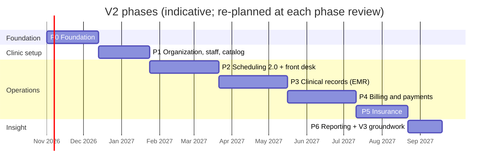
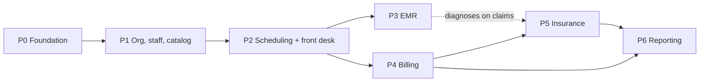

# 10: Roadmap

## 1. Phases at a glance

The durations assume a team of two backend developers, two frontend developers and one QA engineer, with a part-time product owner from the clinic. They are estimates for sequencing, not commitments; each phase is re-estimated at its kickoff. P3 and P4 can overlap partly if the team is larger, because they share only the appointment and patient record.

Each phase ends with a **phase review**: exit criteria met, docs updated (`API_CONTRACT.md` 2.x, `PROJECT_OVERVIEW.md`, REVIEW entries), pilot feedback recorded, next phase re-planned.

## 2. Phases

### P0: Foundation

**Goal:** fix what V2 would otherwise build on top of, and lay the cross-cutting pieces.

| Area | Deliverables | Resolves |
|---|---|---|
| Errors and shapes | Global exception handler, ProblemDetails everywhere, error catalog corrected, `PagedResponse<T>`, timestamps with `Z` | M3, M5, NL9, H6, NL2 |
| Authorization | Permission constants, `IAccessGuard`, `ICurrentUser`, `[HasPermission]`, fallback policy, anonymous allowlist test | NM5, NL10, §4.7 |
| Tenancy | `Organization`, `OrganizationId` backfill, global query filters, tenant interceptor, model test | [ADR 0001](adr/0001-single-organization-tenant-ready.md) |
| Time | `Branch` with time zone (one default branch), `IClock`, `StartsAtUtc` on slots, ban on `DateTime.UtcNow` | M2, §4.1, FR-ORG-06 |
| State | Appointment state machine with the new statuses | M14, FR-APT-01 |
| Events | Domain events, outbox, dispatcher; existing notifications and emails moved onto it | M4 follow-up, NM3, NL6, §4.4 |
| Audit | `AuditEntry` interceptor, append-only permissions | FR-AUD-01, FR-AUD-04 |
| Ops | Health checks, migration bundle, least-privilege DB login, rate limiting, retry strategy, CI pipeline | M12, M6, NM6, NL14, §4.9, §4.10 |

**FRs:** FR-ORG-06, FR-APT-01, FR-AUD-01, FR-AUD-04, and the platform parts of NFR-01…NFR-12.
**Exit criteria:** all V1 tests pass; V1 API behaviour unchanged except the documented fixes (contract 1.x changelog); CI green; permission and tenancy tests in place; outbox delivers V1 notifications.

### P1: Organization, staff and catalog

**Goal:** the clinic exists in the system with its branches, people and price list.

**FRs:** FR-ORG-01…05, FR-STF-01…09, FR-SVC-01…03, FR-AUD-03.
**Deliverables:** branches, rooms, working hours, holidays; staff invitations, roles, scopes, MFA, deactivation; doctor profiles; service catalog and price list; audit viewer; data migration steps 3–5 ([09 §2](09_MIGRATION_FROM_V1.md#2-data-migration)); V1 doctor registration and approval removed.
**Exit criteria:** the clinic's real branches, staff and prices are entered in staging; every role can log in with MFA and sees only its menus; the permission matrix test passes for all P1 permissions.

### P2: Scheduling 2.0 and front desk

**Goal:** one calendar for every booking, and a live waiting room.

**FRs:** FR-SCH-01…10, FR-APT-02…07, FR-APT-09, FR-APT-10, FR-FD-01…06, FR-FD-08, FR-NTF-01…06, FR-SVC-04, FR-RPT-01 (operational part), FR-RPT-04, FR-PAT-01, FR-PAT-02, FR-PAT-08, FR-PAT-09.
**Deliverables:** schedules per branch with shifts, rooms, exceptions, leave and the reschedule worklist; rolling slot generation; booking on behalf, walk-ins, check-in, queue board with SignalR, waiting-room display; reschedule and no-show; SMS/WhatsApp reminders; patient registration with duplicate detection; portal booking by branch and service with prices; consent capture; data migration steps 6–9.
**Exit criteria:** pilot branch runs all bookings (online, phone, walk-in) in ClinicFlow for two weeks; zero double bookings; the queue board is used by desk, nurses and doctors; no-show rate measured.

### P3: Clinical records (EMR)

**Goal:** every visit has a structured, signed record.

**FRs:** FR-EMR-01…15, FR-APT-11, FR-RPT-09, FR-AUD-02, FR-PAT-05, FR-PAT-06.
**Deliverables:** encounters, triage vitals, SOAP templates, ICD-10, prescriptions with allergy checks and PDFs, orders, attachments with storage and scanning, signing and addenda, voids, history timeline, patient visit summaries, read logging, break-glass; data migration step 10.
**Exit criteria:** penetration test passed; privacy checklist items P1, P3, P4 done ([08 §5](08_SECURITY_PRIVACY_COMPLIANCE.md#5-privacy-and-consent)); ≥ 90% of pilot visits have a signed encounter within 24 h; doctors' documentation time measured and accepted by the medical director.

### P4: Billing and payments

**Goal:** every visit is billed and every pound is reconciled.

**FRs:** FR-BIL-01…03, FR-BIL-05…15, FR-APT-08, FR-FD-07, FR-SVC-06, FR-RPT-05, FR-RPT-06, FR-RPT-07, FR-PAT-03, FR-PAT-04.
**Deliverables:** invoices from visits, discounts with approvals, payments by all methods, online gateway with webhooks, receipts, refunds, cash sessions, branch numbering, daily close, deposits and no-show fees, patient balances and statements, approvals inbox.
**Exit criteria:** penetration test of payment flows passed; the pilot branch closes every day in ClinicFlow for two weeks with recorded variances; 100% of completed visits invoiced; the accountant signs off the daily close report against the bank and the POS terminal.

### P5: Insurance

**Goal:** insurance visits are split correctly and claims get paid.

**FRs:** FR-INS-01…12, FR-BIL-04, FR-SVC-05, FR-RPT-08.
**Deliverables:** payers, plans, coverage rules, policies with cards, eligibility recording, pre-authorizations, automatic split, claim batches with validation, exports per payer, remittances, denials and resubmission, aging.
**Exit criteria:** the clinic's top three payers configured; one full monthly claim cycle run from ClinicFlow; claim rejection rate baseline recorded. **V2 general availability:** all branches live; V1 endpoints removed ([09 §3](09_MIGRATION_FROM_V1.md#3-api-migration)).

### P6: Reporting and V3 groundwork

**Goal:** managers decide from data; the platform is ready for more organizations.

**FRs:** FR-RPT-02, FR-RPT-03, FR-RPT-10, FR-APT-12, FR-PAT-07.
**Deliverables:** reporting tables and dashboards, exports, waitlist, dependants; V3 readiness review (tenant resolution by host, platform-operator role design, organization onboarding flow, per-organization settings and branding).
**Exit criteria:** success metrics of [01 §3](01_VISION_AND_SCOPE.md#3-goals) reported monthly; V3 readiness review signed off.

### Not in V2

FR-BIL-16 (e-receipt integration) and FR-INS-13 (electronic payer integration) are *Won't* for V2 and revisited after GA, depending on the open questions below.

## 3. Dependencies

External dependencies: payment gateway contract and sandbox (needed at P4 start), SMS/WhatsApp provider and approved templates (P2), hosting and storage decisions (P0), legal sign-off on the privacy checklist (before P3 go-live), payer claim formats (P5 start).

## 4. Risks

| # | Risk | Likelihood | Impact | Mitigation | Owner |
|---|---|---|---|---|---|
| R1 | Scope is too large for the team; phases slip | High | High | Strict MoSCoW; *Should*/*Could* items move to the next phase rather than delay a phase; phase reviews re-plan | Product owner |
| R2 | Legal requirements (licence, hosting location, retention) delay the EMR go-live | Medium | High | Start legal review in P0; hosting decision before P1; P3 can pilot with consent-based processing once confirmed | Clinic management |
| R3 | Free-text doctor addresses don't map cleanly to branches | High | Low | Manual branch mapping sheet ([09 §2](09_MIGRATION_FROM_V1.md#2-data-migration)) | Backend lead |
| R4 | Frontend capacity (separate repo) lags behind the backend | Medium | High | Shared phase exit criteria; API-first with mock servers from `openapi.json` | Tech lead |
| R5 | Staff resistance; front desk falls back to paper | Medium | High | Pilot branch, super-users, training sandbox, measure adoption weekly, fix friction quickly | Branch managers |
| R6 | Insurer formats differ and change | High | Medium | Configurable export templates per payer; start with the top three payers | Accountant + backend |
| R7 | Payment gateway onboarding takes longer than expected | Medium | Medium | Start the contract in P2; P4 can go live with cash/card POS and add online payments later | Clinic management |
| R8 | Internet outage at a branch stops the front desk | Medium | High | Offline is out of scope; mitigate with a backup 4G link and a printed day list exported each morning; revisit offline support if outages are frequent | IT |
| R9 | A security incident exposes medical data | Low | Very high | [08](08_SECURITY_PRIVACY_COMPLIANCE.md) controls, pen tests before P3/P4, audit and alerts, incident runbook | IT + DPO |
| R10 | Real-time queue doesn't scale with more instances | Low | Medium | Single instance at first; SignalR backplane when scaling | Backend lead |
| R11 | Doctors find structured notes slower than free text | Medium | Medium | Specialty templates, free-text sections allowed, measure documentation time in the pilot | Medical director |

## 5. Open questions

Each needs an owner and a decision date at the phase where it's needed.

| # | Question | Needed by | Options / notes |
|---|---|---|---|
| Q1 | Which payment gateway? | P4 (contract in P2) | Paymob, Fawry, Kashier: compare fees, settlement time, refunds API, card + wallet support |
| Q2 | Which SMS / WhatsApp provider? | P2 | Local SMS aggregator vs international (Twilio, Vonage); WhatsApp Business template approval lead time |
| Q3 | Where is the system hosted, and may data leave Egypt? | P0 | Depends on the legal answer (08 P6); affects storage and provider choices |
| Q4 | Is the clinic in scope of the Egyptian Tax Authority e-receipt / e-invoice system? | P4 | If yes, FR-BIL-16 becomes *Must* and P4 grows |
| Q5 | Which insurers / TPAs does the clinic work with, and what are their claim formats and deadlines? | P5 | Collect sample files from the accountant |
| Q6 | Does the clinic participate in the Universal Health Insurance system? | P5 | Would require a separate integration project |
| Q7 | Drug catalog source for prescriptions? | P3 | Free text only, a licensed Egyptian drug database, or a clinic-maintained list |
| Q8 | Deposit and no-show fee policy? | P4 | Which services, amounts, refund rules |
| Q9 | May doctors edit their own schedules, or only request changes? | P2 | Setting exists; the default needs a decision |
| Q10 | Retention periods for clinical and financial records? | P3 | Legal answer (08 §6) |
| Q11 | Who are the medical director(s) and the DPO? | P1 | Needed for approvals and privacy duties |
| Q12 | Keep `BackgroundService` jobs or adopt Hangfire? | P2 | Decide when jobs need retries and dashboards |
| Q13 | PDF library: QuestPDF licence vs HTML → PDF? | P3 | Depends on the clinic's revenue tier and Arabic rendering tests |
| Q14 | Waiting-room display hardware? | P2 | Smart TV browser vs small PC per branch |
| Q15 | Doctor revenue share: report only, or calculate payouts? | P6 | V2 reports revenue per doctor; payouts are out of scope unless decided |

## 6. Decisions log

| Date | Decision | Record |
|---|---|---|
| 2026-10-09 | V2 = one organization with branches, tenant-ready for V3 | [ADR 0001](adr/0001-single-organization-tenant-ready.md) |
| 2026-10-09 | Roles: Admin, Manager, Receptionist, Nurse, Doctor, Accountant, Patient; permission-based authorization | [ADR 0002](adr/0002-permission-based-authorization.md) |
| 2026-10-09 | Branch time zones; slots store local time + UTC | [ADR 0003](adr/0003-branch-time-zones.md) |
| 2026-10-09 | Appointment state machine in the entity | [ADR 0004](adr/0004-appointment-state-machine.md) |
| 2026-10-09 | `/api/v2` prefix; V1 frozen then removed | [ADR 0005](adr/0005-api-v2-versioning.md) |
| 2026-10-09 | Modules in V2: EMR, billing and payments, insurance; inventory out of scope | [01 §4](01_VISION_AND_SCOPE.md#4-scope) |
